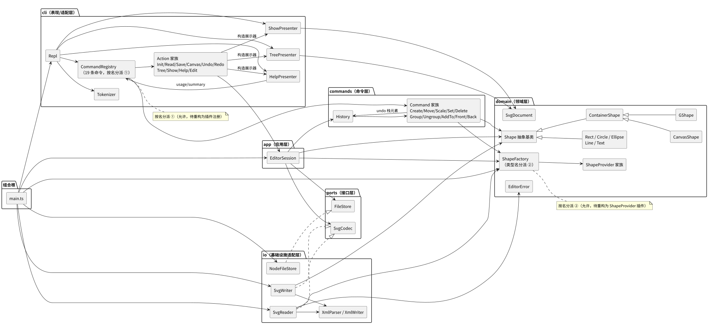

# SVG 编辑器（CLI）— 设计文档

> Lab1 Phase 1 · TypeScript + 面向对象 · Command 模式
>
> 本文档按课程要求分为四节：**架构方案**、**过程记录**、**一致性自查**、**质量保证手段**；附录给出需求文档未显式规定处的工程约定（这些约定同时是测试的断言依据）。
>
> 文档状态：架构方案 v1（实现进行中）。后三节随实现逐步补全。

---

## 1. 架构方案

### 1.1 模块划分

代码按"依赖只能向内"的同心圆分层：**domain 是内核**，commands 在其上表达"编辑动作"，app 编排用例，cli 负责"文本进、文本出"，io/ports 把文件与 XML 关在边界外。

| 模块 | 目录 | 职责 | 对外暴露（其他模块只能用这些） |
|---|---|---|---|
| **domain**<br>领域层 | `src/domain/` | 图形树与几何语义：`Shape` 抽象基类、`ContainerShape`/`CanvasShape`/`GShape`、5 种叶子图形；`SvgDocument`；`ShapeFactory` + 6 个 `ShapeProvider`；属性白名单与 `set` 语义；统一错误类型 `EditorError`。**不依赖任何其他模块**（含 Node API）。 | `SvgDocument`、`Shape` 家族、`ShapeFactory`、`EditorError` |
| **commands**<br>命令层 | `src/commands/` | 10 个编辑命令（`CreateCommand`/`DeleteCommand`/`MoveCommand`/`ScaleCommand`/`SetCommand`/`GroupCommand`/`UngroupCommand`/`AddToCommand`/`FrontCommand`/`BackCommand`），每个命令自带 `execute`/`undo`（重做 = 再次 `execute`）；命令内部保存逆操作所需的局部状态（被删子树、原父与原索引、旧属性值）；`History` 维护 undo/redo 双栈。每个命令类还自带 `static parse(args, ctx)`（命令行语法 → 命令对象）、`commandName`/`usage`/`summary`，供注册表与 `help` 复用；回显句式由命令产生，数字/标签格式复用 domain 的 `NumberFormat`/`Shape.label()`。 | `Command` 抽象类、`History`、各命令类（含静态语法入口） |
| **ports**<br>接口层 | `src/ports/` | 三条抽象边界：`FileStore`（读/写文本文件）、`SvgDecoder`（SVG 文本 → 文档，结果携带 warnings）、`SvgEncoder`（文档 → SVG 文本）。只有接口与类型，无实现、无行为。 | `FileStore`、`SvgDecoder`、`SvgEncoder` |
| **io**<br>基础设施层 | `src/io/` | `NodeFileStore`（Node `fs` 适配）、`SvgReader`（实现 `SvgDecoder`）、`SvgWriter`（实现 `SvgEncoder`）、内部最小 XML 解析/输出（`XmlParser`/`XmlWriter`）、`IdAllocator`（缺 id/重复 id 分配），以及对未支持元素、`transform`、未知 `data-kind` 的告警。 | `NodeFileStore`、`SvgReader`、`SvgWriter` |
| **app**<br>应用层 | `src/app/` | `EditorSession` 门面：持有当前文档与 `History`；处理 `init`/`read`/`save`/`canvas` 四个文档命令；执行编辑命令并写入历史；维护"IO 命令后禁止 undo/redo"闸门与"读入路径"记忆。 | `EditorSession` |
| **cli**<br>表现/适配层 | `src/cli/` | `Repl`（`svg>` 逐行读入、`#` 注释、`exit`/`quit` 元命令）、`Tokenizer`（引号感知分词）、`CommandRegistry`（**19 条命令名 → 命令/动作**，按名分派之一，也是 `help` 的数据源）、9 个会话动作类（`InitAction`/`ReadAction`/`SaveAction`/`CanvasAction`/`UndoAction`/`RedoAction`/`TreeAction`/`ShowAction`/`HelpAction`）+ `EditAction`（把编辑命令包成可执行动作）、`TreePresenter`/`ShowPresenter`/`HelpPresenter`。 | `Repl` |
| **组合根** | `src/main.ts` | 唯一允许 import 全部模块的地方：装配 `NodeFileStore`/`SvgReader`/`SvgWriter` → `EditorSession` → `Repl`。 | `main()` |

组件图（PlantUML 源文件：[`doc/diagrams/architecture.puml`](diagrams/architecture.puml)，渲染版：[`architecture.svg`](diagrams/architecture.svg)）：



关键点：

* **内核与外部世界之间只有三个接口**（`FileStore`、`SvgDecoder`、`SvgEncoder`）。把文件路径、XML 词法、Node API 全部挡在 `io` 里，`domain` 可以用纯内存方式单测。
* **展示文本的归属写在明处**：`tree`/`show`/`help` 的排版由 `cli` 下的三个 `Presenter` 生成；编辑命令的回显句式在命令层（需求逐条规定了句式，见附录 A.1），命令只复用 domain 的 `label()`/`NumberFormat` 做格式化。**模型不依赖 CLI/IO**：`Shape.label()`/内联摘要是领域对象的文本表示（相当于 `toString`），不是 IO 依赖。因此"改 tree 的排版"只动 Presenter，"改回显句式"只动命令，都不会触碰图形几何语义。
* **`CreateCommand` 不自己解析"每种类型几个参数"**：它向 `ShapeProvider` 要"创建该类型需要的属性序列（名字 + 是否必填）"，据此把位置参数按序填入并生成 usage；`read` 解析 SVG 属性用的是同一份属性定义（见 §1.2 Factory）。CLI 语法（位置顺序、可选性）留在命令层，domain 只认识属性名与属性值。
* **两条通道（CLI / 未来的 GUI、agent）共享的是"命令 + 会话"**：命令对象携带语义与逆操作，`EditorSession` 负责历史与文档生命周期；CLI 只是其中一种"把动作变成文本"的适配器。
* **`canvas` 与画布尺寸只有 `CanvasShape` 一处可写**，`init`/`read` 建文档时也只经它；`CanvasShape` 把 `move`/`scale`/`set` 显式拒绝（抛错而非静默 no-op），避免任何"把画布当普通图形"的误用。

**编码规范（需求的范式层要求，落地为可检查的约定）**：

* **一类一文件，文件名 = 类名**（如 `RectShape.ts` → `class RectShape`）；模块内部的"小工具"同样是类（`NumberFormat`、`Tokenizer`、`XmlParser`…），**不写过程式自由函数**。
* **没有贫血模型**：`RectShape` 自己持有 `x/y/width/height` 并实现 `move`/`scale`/`setAttribute`/`attributes`，不存在"数据袋 + 外部函数搬数据"的写法。
* **没有 `switch(tag)`**：几何语义全部是虚方法分派；仅有的两处"名字 → 实现"查表见 §1.2，且都标注为待重构（§1.3）。
* **封装**：字段一律 `private`/`protected`（TS `readonly` 用于 id 等不变量），跨对象只经方法；`SvgDocument` 之外没有任何地方能直接改子节点数组。

### 1.2 设计模式的选择与落地

| 模式 | 落地位置 | 解决的问题 | 备注 |
|---|---|---|---|
| **Command（必需）** | `commands/*Command.ts` + `History`；会话级命令用同一协议（`cli/action/*Action.ts` + `EditAction`） | 把"一条命令"封装为对象，统一 `execute()`/`undo()`；undo 栈只存命令对象，redo 即再次 `execute()`；`group` 一次收编多条图形仍是一个对象 = 一个 undo 单元。命令内部保存逆操作所需的局部状态（被删子树、原父与原索引、旧属性值、`scale` 前的整棵子树几何），**不做整文档快照**。**同一注册表覆盖 19 条命令**（10 个可 undo 的编辑命令 + 9 个会话级动作），因此 `Repl` 里不存在第二套 `if/else` 分派。 | 需求强制要求；同时是"CLI / agent / 鼠标三通道复用同一动作"的接缝 |
| **Composite** | `Shape`/`ContainerShape`/`GShape` | `<g>` 与叶子实现同一接口：`move`/`scale`/`set`/`delete` 对二者一致；容器递归到子孙，删除容器连带整棵子树。 | 需求 §2.1 的明确检验点 |
| **Factory + Provider（注册表）** | `domain/shape/ShapeFactory.ts`、`domain/shape/provider/*.ts` | 类型名 → 构造逻辑。`ShapeProvider` 只描述领域事实：`typeName`/`svgTag`/**创建该类型需要的属性序列（名字 + 是否必填）**/`create(id, init)`/`settableAttributes()`。`CreateCommand` 用这份序列把 CLI 位置参数按序填入，`SvgReader` 用同一份定义解析 SVG 属性；"位置参数的顺序与 usage 文本"留在命令层，domain 不认识 CLI 方言。**按名分派之一（允许），已在 §1.3 标注为待重构**：阶段 2 改为运行时插件注册（ShapeProvider 插槽）。 | 阶段 2 `box` 插件的落点 |
| **Registry** | `cli/CommandRegistry.ts` | 命令名 → 命令/动作（19 条），既做分派也是 `help` 的数据源（每类自带 `usage`/`summary`）。**按名分派之二（允许），标注待重构**：命令表增长后改为扫描注册。 | 需求允许的两处之一 |
| **Facade** | `app/EditorSession.ts` | 对 CLI 只暴露"用例"级方法，隐藏文档替换、历史记录、IO 调用与 undo 闸门的编排顺序。 | 三通道复用的核心 |
| **Adapter** | `io/NodeFileStore.ts`、`io/SvgReader.ts`、`io/SvgWriter.ts`；`cli/action/EditAction.ts`（命令 → 可执行动作） | `FileStore`/`SvgDecoder`/`SvgEncoder` 接口 ← Node `fs` 与自写 XML 实现；命令对象 ← 统一动作协议。 | 便于测试用内存实现替换 |
| **Strategy** | `cli/presenter/*.ts` | 同一份文档的三种展示（tree / show / help）；将来 GUI 或 JSON 输出只需新增 Presenter。 | 展示方式是最易变的部分，故抽离 |
| **Template Method** | `domain/shape/Shape.ts` | 基类给出"标签、属性串、内联摘要、明细行"的骨架（`label()`、`attributes()`、`inlineText()`、`detailLines()`），子类只填自己的几何字段与 `positionText()`，避免每个子类重复拼字符串。 | 5 个叶子图形共享 |

> 说明：需求禁止"到处 `switch(tag)` 的分派"。本设计里**没有**按标签字符串分派：几何语义靠虚拟方法（`move`/`scale`/`setAttribute`/`attributes`）多态实现；仅有的两处"名字 → 实现"查表分别在 `CommandRegistry`（命令名）与 `ShapeFactory`（类型名），即需求允许的两处。

### 1.3 依赖方向规则

**允许的依赖（行 → 列 表示"行可以 import 列"）**：

| from \ to | domain | commands | ports | io | app | cli |
|---|---|---|---|---|---|---|
| **domain** | — | ✗ | ✗ | ✗ | ✗ | ✗ |
| **commands** | ✓ | — | ✗ | ✗ | ✗ | ✗ |
| **ports** | ✓（仅类型） | ✗ | — | ✗ | ✗ | ✗ |
| **io** | ✓ | ✗ | ✓ | — | ✗ | ✗ |
| **app** | ✓ | ✓ | ✓ | ✗ | — | ✗ |
| **cli** | ✓ | ✓ | ✗ | ✗ | ✓ | — |
| **main.ts（组合根）** | ✓ | ✓ | ✓ | ✓ | ✓ | ✓ |

**为什么这样定**：

1. **domain 零依赖**是整份架构的地基：图形语义是本题真正的复杂度所在，它必须能被单测、能被未来的 GUI/agent 直接复用，不能因为"要读个文件"而被 Node API 污染。
2. **commands 只依赖 domain**：命令是"对模型做了什么"的封装，一旦命令开始 import 文件或 REPL，undo/redo 就再也无法脱离 CLI 测试。
3. **ports 只依赖 domain 的类型**：接口签名里出现 `SvgDocument` 是必要的；但接口不含行为，因此它不构成"实现依赖"。
4. **io 反向依赖 ports**（实现接口），**app 只依赖 ports 不依赖 io**：`EditorSession` 在测试里可以注入内存 `FileStore` 与假 codec，IO 命令（init/read/save/canvas 的闸门、路径记忆）不必碰真实磁盘即可测（`test/app/session.test.ts` 即如此）。
5. **cli 只依赖 app + commands + domain**，不碰 io：REPL 不该知道文件是怎么读的。
6. **组合根是唯一的例外**：装配是"知道所有人"的职责，把它限制在 `src/main.ts` 一个文件里，架构就不会因为"顺手 import"而腐化。

**违反规则的判定**：`test/architecture.test.ts` 会扫描 `src/**/*.ts` 的 import 语句，逐条比对上面的矩阵，出现越界边即测试失败；对 `src/ports/**` 额外要求"只能 `import type` 自 domain"（配合 `verbatimModuleSyntax`，可在运行时保持零反向依赖）。因此 §3 的一致性自查不是靠人工抽样，而是每次 `npm test` 都在执行。

**已知的待处理项**（不违反上表，但属于"按名分派"，阶段 2 必须重构）：

| 位置 | 现状 | 阶段 2 目标 |
|---|---|---|
| `cli/CommandRegistry.ts` | 19 条命令名 → 命令/动作的硬编码表（同时是 `help` 的数据源） | 命令提供者注册（与插件机制统一），`help` 自动跟随 |
| `domain/shape/ShapeFactory.ts` | 类型名 → Provider 的硬编码表 | 运行时 `ShapeProvider` 插件注册；`box` 走此路径 |

### 1.4 变化点假设

| # | 变化点 | 未来最可能怎么变 | 为它留了什么 / 为什么决定不留 |
|---|---|---|---|
| 1 | **图形类型集合** | 阶段 2 出现 `box` 插件、更多图元；类型可能来自第三方插件 | **留了**：`ShapeFactory` + `ShapeProvider` 双层结构。Provider 只描述领域事实（`typeName`/`svgTag`/创建属性序列/`create`/可设置属性），新增类型只加一个 Provider 文件、一行注册，`CreateCommand` 与 `SvgReader` 都不用动；CLI 位置参数与 usage 文本留在命令层，插件作者不必懂 CLI 方言。序列化侧 `Shape.svgTag()` 与 `Shape.extraAttributes()` 是虚方法，`box` 可在此写 `data-kind="box"`（本阶段无插件类型，故不产生该属性）。 |
| 2 | **展示/输出通道** | 从 CLI 文本扩展到 GUI 画布、JSON 输出、agent 通道 | **留了**：tree/show/help 已抽成 `Presenter`（Strategy），新增通道只加类。**不留**：编辑命令的回显文本没有抽 `ResultPresenter`——需求逐条规定了句式（附录 A.1），再抽一层会引入"按结果类型分派"的第三个分派点，与需求"只允许两处按名分派"相冲突；GUI/agent 通道直接读 `EditorSession` 的文档与命令对象即可，不需要自然语言。 |
| 3 | **存储与来源** | 文件 → 内存字符串/远端仓库/浏览器下载 | **留了**：`FileStore` 接口只有 `readText`/`writeText`，换实现即可；`SvgDecoder`/`SvgEncoder` 与 Node 无关。 |
| 4 | **寻址方式** | 从 `id` 改为结构路径寻址（`/canvas/g1/rect[2]`，类似 XPath） | **决定不留**：本阶段约定就是 id 唯一。id → (节点, 父节点, 索引) 的定位收敛在 `SvgDocument.locate()` 一个方法里（`findById` 只是它的投影），命令层只用 `locate()`；将来改路径寻址只需换这一个方法，`group`/`addto`/`delete` 这类需要父节点与索引的命令不受影响。 |
| 5 | **容器变换语义** | 用 `<g transform="translate/scale">` 代替"递归改子坐标" | **决定不留矩阵语义**：需求要求 `tree` 内联绝对坐标、`move` 作用于容器时"整体平移"，直接改子坐标与之一致，序列化也简单。**但对读入的文件不静默丢信息**：`transform` 原样进 `extras`、`save` 写回，`tree`/`show` 显示的仍是局部坐标，并给出 `warning: transform not applied: g#diagram`。若将来实现矩阵语义，改动集中在 `GShape.move/scale` 与 `SvgWriter` 两处。 |
| 6 | **撤销策略** | 命令数激增后，逐命令实现 `undo` 容易出错 → 整文档快照（Memento 全量） | **决定不留全量快照**：Command 模式是评分硬要求，且逆操作比快照省内存。`History` 的接口（`record`/`peekUndo`/`commitUndo`/`peekRedo`/`commitRedo`/`clear`）不随策略变化，替换命令实现即可。`scale` 的 undo 存"子树旧几何"而不是按 `1/factor` 反算，避免浮点漂移。 |
| 7 | **属性白名单** | 新增 `opacity`、`font-size`、`transform` 等可设置属性 | **留了一半**：`set` 白名单在 `Shape` 子类的 `settableGeometryAttributes()`/`setAttribute()` 里按类型实现，新增属性只改对应类；**未知属性在读取时原样保留**（`Shape.extras`），保证 `read → save` 不丢外部文件的额外属性。 |
| 8 | **XML 解析实现** | 自写解析器不够用（命名空间、CDATA、实体）→ 换成熟库 | **留了**：`io/xml/` 是独立子模块，只被 `SvgReader`/`SvgWriter` 使用；换实现不波及任何其他模块。本阶段选零依赖自写，是为了可离线、可测试、可解释每一行行为。 |
| 9 | **画布/视口** | 增加缩放、平移视图、多画布/多文档 | **留了**：画布尺寸只有 `CanvasShape` 可写，`canvas` 命令单点修改；多文档将来只需让 `EditorSession` 持有文档列表（`History` 与命令都以"传入的 document"为参数，不持有全局单例）。 |
| 10 | **命令集合与语法** | 阶段 2 增加插件命令（如 `plugin load`）、新子句（`in` 已是先例） | **留了**：每条命令自带 `static parse(args, ctx)` 与 `usage`/`summary`，`Tokenizer` 只做引号感知分词，注册表只做"名字 → 命令类"；新增命令 = 新增类 + 表里一行，不需要改分词器或 Repl。 |
| 11 | **插件来源与信任边界** | 插件从目录/URL 加载；版本不兼容、加载失败、`data-kind` 无法识别时需要降级 | **留了**：`ports/PluginSource`（阶段 2 新增）+ 组合根装配；降级规则现在就定：`read` 遇到未知 `data-kind` 时**降级为普通 `<g>`** 并告警（与需求 §4.4 "未安装插件降级为 g"一致）。本阶段无插件实现，但读取路径已按此规则工作。 |
| 12 | **undo 组合/宏** | 脚本回放、批量操作需要"多条命令 = 一个 undo 单元" | **留了**：`History` 以命令对象为单元，`GroupCommand` 已是"多目标单命令"的特例；阶段 3 只需加 `CompositeCommand` 聚合子命令（`execute` 顺序执行、`undo` 逆序撤销），`History` 与 Repl 都不用改。 |

---

## 2. 过程记录

> 本节记录实现过程中关键、有代表性的讨论与迭代（AI 建议 → 我发现的问题 → 如何确认与纠正）。按时间顺序追加。

### 2.1 架构方案的第一轮独立评审（AI 评审 → 我的裁定）

第一版架构方案写完（§1 + 附录 A/B）后，我让一个**独立上下文的评审 agent** 只读评审（输入：需求文档、本方案、PlantUML 源），要求只报"会在实现中咬人"的问题、不要泛泛而谈。它给出 12 条，我逐条判断，其中 3 条属结构性真问题，直接改了方案；2 条只采纳一半并说明理由。关键迭代如下：

| # | 评审发现 | 我的判断与处理 |
|---|---|---|
| 1 | 注册表只覆盖 10 个编辑命令，init/read/save/canvas/tree/show/help/undo/redo 在 Repl 里只能 `if/else` → 出现**第三个按名分派点**，且 `help` 拿不到完整命令表 | **采纳（真问题）**：改成一张表 19 条命令；会话级命令用同一 `run()` 协议（`cli/action/*`），`EditAction` 把编辑命令适配成动作；`help` 直接从注册表生成，Repl 不再特判。§1.1/§1.2/§1.3 已同步。 |
| 2 | 编辑命令直接返回回显文本，与"CLI 文本变更不波及模型"的声明矛盾；建议抽 `ResultPresenter` | **部分采纳**：抽 `ResultPresenter` 会引入"按结果类型分派"的**第三个分派点**，与需求"只允许两处按名分派"冲突。改为：命令保留回显，但删掉 §1.1 的过度声明，明确"模型只提供自身文本表示（`label()`/内联属性），回显句式属于命令层契约"，并复用 domain 的 `NumberFormat`/`label()` 统一格式。§1.4#2 的理由重写为"避免第三个分派点 + 跨通道共享的是命令对象而非自然语言"。 |
| 3 | `addto` 无环检测，`addto node1 flowchart` 会让子树自包含 → tree/save/计数无限递归 | **采纳（真问题）**：`group`/`addto` 共用祖先检查；新增错误 `cannot move a container into its own descendant: g1` 写进附录 B，测试覆盖祖先/自身/正常三种情况。 |
| 4 | `ShapeProvider` 携带 CLI 位置参数 schema → domain 反向依赖 CLI 方言 | **采纳思路、改落点**：Provider 只暴露"创建该类型需要的属性序列（名字 + 是否必填）"——这是类型事实，且与序列化顺序一致；位置参数顺序、usage 文本、引号解析留在命令层。domain 仍不认识 CLI。 |
| 5 | `transform` 的三种说法互斥（忽略 / 保留进 extras / 附录 C 说不做）；auto-id 口径有三种读法，会改变 transcript | **采纳（真问题）**：定为"保留到 extras + `save` 写回 + `tree` 显示局部坐标 + 告警"；auto-id 定为"同标签递增计数器、跨文档累加、跳过已占用 id"。附录 A.7 已明确并加例子。 |
| 6 | `group`/`ungroup`/`front` 的插入位置未定义，而需求 §6 transcript 的 tree 顺序恰恰依赖它 | **采纳**：§A.9 补四条（`group` 追加到第一个目标父容器末尾、内部顺序按命令行；`ungroup` 原位替换；`front/back` 索引 0-based；跨父容器允许）。 |
| 7 | §1.4 漏了"命令集合与语法""插件来源与信任边界""undo 组合/宏"三个真变化点 | **采纳**：§1.4 由 9 条增加到 12 条。 |
| 8 | 非 TTY 回放的 prompt/banner/输出流未定义，transcript 断言会脏 | **采纳**：`Repl` 只负责"行 → 结果行"；banner/prompt 由 `main.ts` 按 TTY 决定；错误与结果都走 stdout（需求 transcript 中二者同流）。 |
| 9 | `tree` 对齐的"可复现"理由不成立：需求示例其实是各自对齐到**绝对列**（约第 19/29/26 列），我的规则复现不了任何根级示例 | **采纳（我原来的理由是错的）**：重写 §A.8，承认本工程规则"不与任何示例逐字一致"，测试用本工程 golden 输出 + 结构等价断言，不对需求 transcript 做 naive diff。 |
| 10 | `CanvasShape` 也是 `ContainerShape`，`in`/`addto` 校验若写 `instanceof ContainerShape` 会接受 `svg` | **采纳**：`in`/`addto` 只认 `GShape`；`CanvasShape.move/scale/set` 显式抛错；尺寸只走 `resize()`；tree 根行由 Presenter 特判。 |
| 11 | A.9 与 A.1/§1.4 互斥：`canvas` 无参是否置闸门、`History` 没有 `clear()`、redo 清空表述自相矛盾、`save`/`init` 的路径记忆未定义 | **采纳**：A.1 改为"只显示、不置闸门、不入历史"；`History` 增 `clear()`；redo 只在编辑命令**成功**后清空；`save <file>` 成功后更新路径、`init` 重置路径。 |
| 12 | 杂项：附录 B 缺 `unknown attribute`；`scale` 的 undo 与"存旧值"冲突；`findById` 不是唯一遍历入口；架构测试要区分 `import type`；组件图缺 `main` 与 Presenter 边 | **采纳**：全部落地（附录 B 补齐；`scale` undo 存子树旧几何；新增 `SvgDocument.locate()`；架构测试加 `import type` 规则；组件图补边）。 |

评审也顺带验证了方案的两个基本判断：**依赖矩阵自洽无环**、**ports/io/app 的边界与 Presenter 放 cli 是合理的**。这一轮之后方案定稿，开始实现（§2.2 起按模块记录实现中的问题）。

### 2.2 实现期记录（domain + commands）

自底向上先做领域层与命令层，每层写完立刻跑单测（20 个用例，见 `test/domain`、`test/commands`）。过程中真正暴露出来的问题：

| # | 现象 | 根因 | 处理 |
|---|---|---|---|
| 1 | `scale` 之后 `rect.x()` 得到 `0.30000000000000004`（`0.1 * 3`） | 内部用 double 存几何，浮点噪声在原始字段里 | 决定**内部保留 double、输出统一走 `NumberFormat`**（6 位小数、去尾零）；`scale` 的 undo 存"旧几何的格式化快照"而非按 `1/factor` 反算，撤销后能精确回到 `0.1`。测试改为断言"对外视图"（`geometryAttributeEntries()`），不绑定内部 double |
| 2 | `addto` 的环检测文案该点名哪个 id？`group` 的例子点名的是"容器"（`markers`） | 两个命令的语义方向相反：group 是"把图形收进容器"，addto 是"把图形移进容器" | `group` 保留需求文案（点名容器）；`addto` 按"**被移动的那个容器**"点名（`addto node1 flowchart` → `cannot move a container into its own descendant: flowchart`），更符合"它会被挂进自己的子孙"的直觉。附录 B 同步 |
| 3 | `group markers c1`（只给一个目标）该不该允许？ | 需求语法是 `group <newGid> <id1> <id2>…` | 要求至少 2 个目标，否则报 usage；"只收编一个"用 `addto` 更自然，避免两个命令语义重叠 |
| 4 | 首次 `tsc --noEmit` 报 4 条 `Cannot find module` | `provider/` 子目录里的相对 import 少写了一级（`../` 应为 `../../`） | 由严格类型检查立即发现并修正；这也是"每层写完就跑 typecheck + 单测"的直接收益 |
| 5 | 文档与实现的两处同步 | 评审把 `findById` 降级为 `locate()` 的投影；`CanvasShape` 需要显式拒绝图形操作 | 实现按评审后的方案落地：`SvgDocument.locate()` 是唯一 id 定位入口，`findById` 委托它；`CanvasShape.move/scale/setAttribute` 抛 `cannot modify the canvas as a shape`（有单测覆盖） |


---

### 2.3 实现期记录（io + app + cli）

| # | 现象 / 决策点 | 处理 |
|---|---|---|
| 1 | 首版方案的 ports 只有一个 `SvgCodec`（读+写合一）。实现 `SvgReader` 时发现它需要 `ShapeFactory`（按标签造节点），而 `SvgWriter` 不需要；`EditorSession` 同时注入一个"读写合一"的对象会让依赖变宽 | **拆成 `SvgDecoder` / `SvgEncoder` 两个接口**，`EditorSession(files, decoder, encoder)` 注入。这是"实现推动架构修正"的一例：§1.1/§1.2/§1.3 与组件图都已同步，`test/architecture.test.ts` 的 `import type` 规则也按新接口校验 |
| 2 | `save` 该不该清空 undo 栈？评审只说了"IO 命令后禁止 undo" | **save 只置闸门、不清历史**（否则"保存前"的编辑永远失去撤销机会）；init/read/canvas 带参才清历史（文档已被替换或尺寸被改，旧命令不再意义）。与附录 A.9 一致 |
| 3 | "命令失败不改变任何状态"如何保证？ | 约定：先校验后修改；`save` 先 `encode` 再 `write`、成功后才更新路径与闸门；`undo` 栈在命令抛错前不 `record`。`test/app/session.test.ts` 用"不可写文件""不存在的 id"两种失败路径各断言一次 |
| 4 | 交互式 banner/`svg> ` 的输出归属 | banner/prompt 由 `main.ts` 依据 `isTTY` 决定，`Repl` 只接收配置；管道回放时输出只有命令结果，golden test 因此无需剥提示符。沙箱拿不到 pty（`script` 报 Permission denied），交互外观由 `test/cli/repl.test.ts` 断言两种配置下的精确输出，**真实 TTY 未实测**（记为已知局限） |
| 5 | `read` 读入 `<text>` 的内容边界与画布尺寸来源 | 初版只取 `<text>` 的直接文本、`<tspan>` 内容被丢；第二轮评审指出后改为**按顺序展平并告警**，缺 `width`/`height` 时回退 `viewBox`（见 §2.4） |
| 6 | `show <g>` 该显示什么？ | 首行 label+parent，随后几何/样式明细，容器追加 `children=N`（附录 A.4 已声明）。`tree` 的内联属性对容器只显示 `fill`（若有），与需求示例一致 |
| 7 | 测试期望写错一次 | 我最初把"init 后 undo"期望成 `nothing to undo`，实际实现按需求 §4.3 报 `undo not allowed after io command`。**修正的是测试而不是实现**——这条也说明"先写契约、再对代码/测试双向校验"的价值 |
| 8 | tree 对齐无法与需求示例逐字一致 | 按 A.8 的裁定生成**本工程 golden**，不对需求 transcript 做 naive diff；`§6`/`§6.1` 的断言以本工程规则为准，语义（结构/属性/回显）与需求一致 |

### 2.4 第二轮独立评审（实现评审 → 修复）

实现完成、§3/§4 写完后，我让第二个独立上下文的评审 agent 只读评审"代码 + 文档"，明确要求**实际运行命令验证**而不是只读代码。它给出 15 条；其中 2 条基于评审启动时的旧快照（当时我还没提交 remote 配置与 §3/§4），复核后确认已满足；其余 13 条我逐条复现，9 条是真问题、已修，4 条属文档/测试细节、一并修正。关键几条：

| # | 评审发现（可复现证据） | 处理 |
|---|---|---|
| 1 | **大数格式化静默损坏 SVG**：`format(1e300)` → `1e+3`（去尾零把指数吃了）、`format(1e308)` → `Infinity`；`move r1 1e300 0` 后 save 得到 `x="1e+3"`，读回差 297 个数量级 | 量级 ≥1e21 或 <1e-6 改用科学计数法（SVG 数字语法允许 `1e+300`）；几何运算后校验有限性，溢出报 `<attr> is out of range` 且不写入；新增 3 个单测 |
| 2 | **undo 失败会把历史搞乱**：旧 `History` 先移栈后执行，undo 抛错后命令丢失，再 undo 会误撤上一条（配合 #1 的 Infinity 可真实触发） | `History` 改为**两阶段提交**（`peekUndo` → 执行成功 → `commitUndo`；redo 同构），失败则栈不变；与 #1 的有限性保护共同杜绝"文档坏了、历史也错位" |
| 3 | **双 `ShapeFactory` 实例**：`EditorSession` 内部 new 一个，`main` 又给 `CommandRegistry`/`SvgReader` 各传一个 → 文档承诺的"插件只注册一处"不成立 | 构造函数注入**同一个**实例：`EditorSession(files, decoder, encoder, shapes)`；main 与全部测试同步更新 |
| 4 | `<text><tspan>nested</tspan></text>` 的内容被静默丢弃；`viewBox` 被忽略，缺 width/height 时回退 800×600 | 文本按文档顺序展平 + 告警 `flattened nested elements in text#t1`；缺 width/height 时先回退 `viewBox`；新增 2 个单测 |
| 5 | `canvas 400` 报 usage，而 `init 400` 成功——同族命令行为不一致 | `canvas <w>` 只改宽度、高度沿用当前值（`canvas <w> <h>` 仍为完整修改），附录 A.1/A.9 声明 |
| 6 | 悬空 `in` 被当成 fill：`create rect r 0 0 10 10 in` → `fill="in"`；空 id 被接受：`create rect "" …` 造出 `id=""` | 前者报 `usage`（text 内容为 `"in"` 的合法场景不受影响），后者报 `invalid id: id must not be empty`；附录 B 补齐 |
| 7 | 5000 层嵌套 `<g>` 的文件让 `read` 抛 `RangeError` 并打印堆栈退出 | XML 解析限深 256 层（报 `invalid svg: nesting too deep`）；`Repl` 顶层兜底非预期异常为 `error: internal error: …` 并继续 |
| 8 | 中文 id 在 tree 里错列（`length` 按 1 列计，CJK 实际 2 列） | 新增 `cli/DisplayWidth`（全角按 2 列），tree 对齐改用它；新增 CJK 对齐 golden 用例 |
| 9 | 文档/测试细节：附录 B 的 usage 示例与实现不符并缺 3 条错误；组件图有 3 条不存在的依赖边；`CommandHarness` 自实现 undo/redo 双栈（与产品 `History` 脱耦） | 以 `grep "new EditorError" src` 对齐附录 B；组件图删假边、改 `History` 方向、补 `NumberFormat`/`SvgDocument` 边并重新渲染；harness 改用真实 `History`；新增 11 个回归用例（跨父 `group`、save→read 回读、read 失败保留文档、失败编辑不清 redo、canvas 单参、空 id/悬空 `in`、大数、tspan/viewBox、深嵌套、CJK 对齐） |

**被驳回/记为局限的**：

* "提交时间戳聚簇"——承认：本工程按层推进，同一层内多条命令在秒级完成，时间戳确实成簇；**不伪造时间线**（诚信优先），但每一层都是可独立运行、可测试的提交，history 从 docs → 脚手架 → domain → commands → io → app → cli → tests 递进。
* "交互式 TTY 外观未实测"——保留为已知局限（沙箱无 pty），只有配置行为的单测。
* 2 条旧快照项（remote 未配、§3/§4 空白）——复核时已满足，无需修改。

## 3. 一致性自查

> 实现完成后对照 §1 的回答（依据 `git log`、`npm test` 与本文档）。

### 3.1 模块划分：实际目录与方案是否一致？

**一致，且有 1 处已记录的修订**：

| 方案里的模块 | 实际目录 | 一致性 |
|---|---|---|
| domain | `src/domain/`（shape/ + provider/ + SvgDocument + NumberFormat + EditorError） | ✓ |
| commands | `src/commands/`（Command + 10 个命令 + History + 解析上下文） | ✓ |
| ports | `src/ports/`（`FileStore`、`SvgDecoder`、`SvgEncoder`） | ✓（**修订**：原方案写 `SvgCodec` 一个接口，实现时拆为读/写两个，见 §2.3#1） |
| io | `src/io/`（NodeFileStore、SvgReader、SvgWriter、xml/**、IdAllocator） | ✓ |
| app | `src/app/EditorSession.ts` | ✓ |
| cli | `src/cli/`（Repl、Tokenizer、CommandRegistry、CommandEntry/ActionEntry、action/**、presenter/**） | ✓ |
| 组合根 | `src/main.ts` | ✓ |

`test/` 是测试代码、不参与产品分层；`doc/diagrams/` 是文档附图。除 ports 拆接口外，没有其它目录级偏差；例如没有出现"顺手把解析逻辑塞进 domain"或"在 cli 里直接读文件"的情况。

### 3.2 依赖方向：方案里的规则有没有被违反？

**没有违反，且是自动检查而非抽样**：

* `test/architecture.test.ts`（2 个用例，`npm test` 每次都跑）逐条扫描 `src/**/*.ts` 的 import：
  * 按 §1.3 的矩阵检查模块边界（越界即失败）；
  * `src/ports/**` 对 domain 只允许 `import type`；
  * 平台 API（`node:*`）只允许出现在 `io/` 与 `main.ts`；
  * 禁止第三方运行时依赖；
  * 模块级依赖图无环。
* 人工抽样（对照矩阵再确认一遍）：`EditorSession` 只 import domain/commands/ports；`Repl` 只 import app 与 cli 内部，**不触碰 io**；`SvgReader`/`SvgWriter` 只 import domain/ports/io 内部；`domain` 内没有任何跨模块 import。
* §1.3 标注的两处"按名分派"仍是仅有的两处：`cli/CommandRegistry`（19 条）与 `domain/shape/ShapeFactory`（6 个 Provider）；domain/commands 内没有 `switch(tag)`（`grep` 无 `switch` 语句，几何语义全部是虚方法）。

### 3.3 与方案不一致的其它地方（如实记录）

| 不一致处 | 说明 |
|---|---|
| ports 接口数 1 → 2 | 见 §2.3#1，已在 §1.1/§1.2/§1.3 与组件图同步 |
| `tree` 内联对容器显示 `fill` | 规则是"几何 + fill"，容器无几何时只剩 fill；需求示例未出现容器带 fill 的情况，属规则的自然结果 |
| `show` 容器追加 `children=N` | 需求只给了叶子的 show 示例，附录 A.4 已声明 |
| 补充的错误文案 | 需求 §4.2 未覆盖的场景（duplicate shape in group / addto 环 / ungroup 叶子 / invalid svg / usage / invalid number / no file path / nothing to undo·redo / redo 闸门）在附录 B 逐条列明 |

**结论**：实现与架构方案一致；唯一的结构性修订（ports 拆接口）已记录并在文档中同步，没有出现"文档说一套、代码做一套"的未记录偏差。


---

## 4. 质量保证手段

**结论先行**：`npm test` **59 个用例**全绿、`npm run typecheck` 无错误、`npm run build` 产物可运行、需求 §6/§6.1 的两段 transcript 逐行断言通过，第二轮独立评审提出的 9 个真问题全部修复并有回归用例。信心来自以下六层，而不是"看起来能跑"：

### 4.1 分层单测（59 个用例）

| 层 | 用例数 | 覆盖点 |
|---|---|---|
| domain | 11（`test/domain`） | 五种叶子的 move/scale/set/属性视图、容器递归、画布拒绝图形操作、数字格式化（浮点噪声/整数/-0/极大极小值）、几何溢出保护、Provider 创建与未知类型报错 |
| commands | 14（`test/commands`） | 10 个命令的 execute/undo/redo 回显、结构变化、错误路径（id 重复、容器不存在/类型不对、祖先环、重复目标、越界参数、非正因子、悬空 `in`、空 id、跨父 `group`）；`History` 两阶段提交（undo 抛错不丢命令） |
| io | 10（`test/io`） | XML 声明/注释/实体/CDATA/自闭合/结构错误/嵌套深度；缺 id、重复 id、未支持元素、非法几何、`transform`、未知 `data-kind`、`<tspan>` 展平、`viewBox` 回退；属性顺序与转义；**编码→解码→编码 幂等** |
| app | 10（`test/app`） | IO 闸门与解除、redo 栈清空、路径记忆（read/save/init）、告警顺序与计数口径、canvas 显示 vs 改尺寸、写失败不改状态、失败命令不入栈 |
| cli | 12（`test/cli`） | 注册表 19 条完整性 + help 自动生成；分词（引号/未闭合）；banner/prompt 两种模式；**需求 §6 与 §6.1 的完整 transcript 逐行 golden**（含 save 文件内容逐字比对）；save→read 回读、CJK 对齐、canvas 单参、悬空 `in`/空 id/超深嵌套文件的健壮性 |
| 架构 | 2（`test/architecture.test.ts`） | 依赖矩阵、`import type` 规则、平台 API 白名单、无第三方依赖、依赖图无环 |

### 4.2 端到端 transcript 断言

需求文档 §6 的完整会话与 §6.1 的流程图会话都被当作**契约测试**：命令序列逐条输入，输出逐行比对（包括 `warning:` 与 `error:` 行、tree 结构、undo/redo 回显、`(N elements)` 计数）；`save` 的产物再与期望的 SVG 文本逐字比较。任何一行回显变化都会让测试失败。

### 4.3 架构守护测试

§1.3 的依赖矩阵不是"写在文档里的君子协定"：`test/architecture.test.ts` 解析 `src/**/*.ts` 的 import，越界依赖、`ports` 的非 `import type` 依赖、非 io/main 使用 `node:*`、引入第三方运行时依赖、模块级循环依赖，任何一项都会让 `npm test` 失败。这同时是 §3.2 自查依据。

### 4.4 严格类型与可构建性

* `tsconfig` 开启 `strict`、`noUncheckedIndexedAccess`、`noImplicitOverride`、`noPropertyAccessFromIndexSignature`、`verbatimModuleSyntax`、`isolatedModules`；
* `npm run build` 用独立 tsconfig（`rootDir: src`）编译到 `dist/`，并用 `node dist/main.js` 实跑同一段会话，确认 ESM 产物（含 `.js` 扩展名 import）可执行。

### 4.5 错误路径与"失败不改状态"

附录 B 的每一条错误文案都至少有一个用例覆盖；三条"原子性"约定各有专门测试：create/group/addto/ungroup 先校验后修改、`save` 先编码后写盘成功才更新路径与闸门、失败命令不进入 undo 栈。

### 4.6 手工冒烟与已知局限

* 额外手工跑了一组边界会话（嵌套容器 scale、`front/back`、跨父 `group`、`addto` 环、`save → read` 回读、`set` 旧值不存在时 undo 移除属性），结果与附录 A 一致；
* **已知局限（未覆盖）**：交互式 TTY 外观未实测（沙箱无法分配 pty，只有单测确认配置行为）；不支持命名空间前缀、`clipPath`/`mask`/`defs` 等非图形元素（按 A.7 跳过并告警）；`<text>` 内的子元素文本会被展平、丢失内嵌样式；无性能/压力测试（当前规模 <1000 节点）；
* 第二轮独立评审的结论与修复记录见 §2.4（若评审未提出需修复项，此处会写明"无阻断项"）。

---

## 附录 A：CLI 输出约定（需求文档未显式规定处）

需求文档给出了典型 transcript，但未覆盖全部命令的回显、以及若干格式细节。以下为工程约定，**同时是自动化测试的断言依据**。

### A.1 成功回显

引用图形的写法统一为 `类型#id`（如 `rect#bg`、`g#markers`）。

| 命令 | 回显 | undo 回显 | redo 回显 |
|---|---|---|---|
| `create`（根） | `rect#bg created` | `rect#bg deleted` | 同 create |
| `create … in g` | `rect#start created in g#node1` | `rect#start deleted` | 同 create |
| `delete` | `rect#box deleted` | `rect#box restored into g#markers` | 同 delete |
| `move` 叶子 | `circle#c1 moved to (130,100)` | `circle#c1 moved back to (100,100)` | 同 move |
| `move` 直线 | `line#l1 moved to (10,20) -> (110,120)` | `… moved back to (0,10) -> (100,110)` | 同 move |
| `move` 容器 | `g#node2 moved by (0,100)` | `g#node2 moved back by (0,-100)` | 同 move |
| `scale` | `circle#c1 scaled by 2` | `circle#c1 scaled back by 2` | 同 scale |
| `set` | `rect#r1 updated: fill=red`（text 内容加引号：`updated: text="v2"`） | 回显旧值，如 `updated: fill=#eee` | 同 set |
| `group` | `g#markers created with 2 children` | `g#markers dissolved (2 children restored)` | 同 group |
| `ungroup` | `g#node1 ungrouped (2 children moved to g#flowchart)` | `g#node1 restored` | 同 ungroup |
| `addto` | `rect#r1 moved into g#g1` | `rect#r1 moved back to svg` | 同 addto |
| `front` / `back` | `rect#r1 moved to front` / `… to back` | `rect#r1 moved back to index 2` | 同 front/back |
| `canvas`（无参） | `canvas 800x600` | —（只显示，不置闸门、不入历史） | — |
| `canvas w` | `canvas resized to 1024x600`（只改宽度，高度沿用） | —（IO 命令） | — |
| `canvas w h` | `canvas resized to 1024x768` | —（IO 命令） | — |
| `init` | `canvas 800x600 created` | —（IO 命令） | — |
| `read` | `read other.svg (7 elements)` | —（IO 命令） | — |
| `save` | `saved to demo.svg (5 elements)` | —（IO 命令） | — |

* `undo`/`redo` 无历史时：`error: nothing to undo` / `error: nothing to redo`。
* IO 命令之后的闸门：`error: undo not allowed after io command` / `error: redo not allowed after io command`。
* 提示性输出：`warning: assigned id rect1 to unnamed <rect>`，**先于**命令结果输出。
* 所有错误单行、前缀 `error:`；所有命令失败不改变任何状态（先校验后修改）。

### A.2 元素计数口径

`read`/`save` 的 `(N elements)` 中 N = **画布根以下的图形元素个数**（含 `<g>` 容器，不含根 `<svg>`）。例如需求文档 §6 的 `demo.svg`：`bg/title/c1/box/markers` = 5。

### A.3 `tree` 格式

* 根行：`svg (WxH)`；
* 子行：`├── ` / `└── ` / `│   ` 组成的树形前缀；
* 内联属性：只显示几何 + `fill`（需求文档的示例中 `line` 虽带 `stroke` 但 tree 不显示，以此为准）；
* 对齐：**同一父节点下的兄弟为一组**，label 补齐到"组内最长 label + 2"；无内联属性的行（如 `<g>`）不补尾随空格；
* 叶子内联写法：rect `x=0 y=0 w=800 h=600 fill=#ffffff`；circle `cx=100 cy=100 r=20 fill=red`；ellipse `cx=1 cy=2 rx=3 ry=4`；line `(280,130) -> (520,130)`；text `(20,40) "My Diagram"`。
* `tree <id>`：只输出以该 id 为根的子树；根行即该图形的 label + 内联属性（不再出现 `svg (WxH)` 行），子行照常缩进。

### A.4 `show` 格式

```text
circle#c1  parent=g#markers
  cx=100 cy=100 r=20
  fill=red
```

* 首行：`类型#id` + 两个空格 + `parent=父label`（根级为 `parent=svg`）；
* 明细行 2 空格缩进，顺序：几何（用 SVG 全名，如 `width=`/`height=`）→ `fill`/`stroke`/`stroke-width`（仅已设置的）→ text 的 `text="…"` → 容器的 `children=N`。

### A.5 数字格式

整数不带小数点（`20` 而非 `20.0`）；非整数最多 6 位小数并去掉尾随 0；避免 `0.30000000000000004` 这类浮点噪声。

### A.6 SVG 输出格式

```xml
<?xml version="1.0" encoding="UTF-8"?>
<svg xmlns="http://www.w3.org/2000/svg" width="800" height="600" viewBox="0 0 800 600">
  <g id="flow">
    <rect id="start" x="30" y="70" width="120" height="60" fill="#4a90d9"/>
  </g>
</svg>
```

* 2 空格缩进；空容器写 `<g id="x"/>`；
* 属性顺序：`id` → 几何属性（各类型的固定顺序，见需求 §4.1）→ 样式属性（`fill`/`stroke`/`stroke-width`）→ 读入时保留的未知属性；
* `text` 的内容为子文本节点（文本节点转义 `& < >`；属性值另需转义 `"`）；
* 根元素写 `width`/`height`/`viewBox="0 0 W H"`。

### A.7 `read` 的容错

| 情况 | 行为 |
|---|---|
| 元素缺 `id` | 按"**同标签递增计数器**"补 id（`rect1`、`rect2`…；计数器跨整个文档按标签累加，并跳过文档中已占用的 id），并输出 `warning: assigned id rect1 to unnamed <rect>`。例：文档里第一个 `<rect>` 若是第 3 个元素，仍得 `rect1`；若 `rect1` 已被占用，则得 `rect2` |
| `id` 重复 | 后出现的元素重新分配（先出现者保留）：`warning: assigned id rect2 to duplicate id rect1` |
| 未支持的 SVG 元素（如 `<polygon>`） | 跳过并警告 `warning: unsupported element <polygon> ignored` |
| `<g>` 上的 `transform` | 本阶段无变换矩阵运算：`transform` **原样保留到 `extras` 并在 `save` 时写回**（不丢信息），`tree`/`show` 显示的是局部坐标，同时告警 `warning: transform not applied: g#diagram`。阶段 2 引入 transform 后改为真正烘焙 |
| 未知 `data-kind`（如阶段 2 的 `box`，但插件未安装） | 按需求 §4.4 降级为普通 `<g>`（属性原样保留），告警 `warning: unknown shape kind 'box', kept as plain g` |
| 缺少 `width`/`height` | 先回退到 `viewBox` 的第 3/4 个数，再回退 800×600 |
| `<text>` 内有子元素（如 `<tspan>`） | 按文档顺序**展平**文本（不丢内容），并告警 `warning: flattened nested elements in text#t2` |
| 嵌套过深（> 256 层） | 报 `error: invalid svg: nesting too deep (max 256)`，不打印堆栈、不崩溃 |
| `id` 为空字符串 | 视同"未命名"，重新分配并告警 |

### A.8 与需求文档示例的差异裁定

| 项 | 需求示例 | 本文档裁定 | 理由 |
|---|---|---|---|
| `tree` 对齐宽度 | 各代码块各自对齐到一个**绝对列**（实测约第 19 / 29 / 26 列），块与块之间互不一致 | 统一为"组内最长 label + 2" | 需求示例无法同时满足；本工程规则**不与任何示例逐字一致**，但语义信息完全一致。测试用"本工程 golden 输出 + 结构等价断言"，不对需求 transcript 做 naive diff |
| `move` 对 rect/line/text 的回显 | 只给了 circle（`moved to`）与 g（`moved by`） | 有单一锚点的叶子用 `moved to (x,y)`，line 用 `->` 两段表示，容器用 `moved by (dx,dy)` | 与 `tree` 的位置表示一致，且保留"容器整体平移"与"叶子定位"的语义差异 |
| `scale`/`ungroup`/`addto`/`front`/`back` 回显 | 未给出 | 按 §A.1 的"命令 + 宾语 + 结果"句式统一 | 需求只约束了部分句式；统一句式便于脚本回放与测试断言 |
| `scale` 是否缩放 `stroke-width` | 未说明 | 不缩放，只缩放几何属性（位置与尺寸） | 需求原文"factor 同乘到图形的全部几何属性（位置与尺寸）" |
| `undo`/`redo` 空栈 | 未给出 | `error: nothing to undo` / `error: nothing to redo` | 与"错误单行、带前缀"的约定一致 |

### A.9 行为细则（需求未逐条规定、但影响可测性的部分）

| 规则 | 说明 |
|---|---|
| `create` 省略 `fill`/`stroke` | **不写入该属性**（外观走 SVG 初始值），因此 `attributes()` 里也不出现；`show` 不显示该行 |
| `set` 白名单 | 所有图形：`fill`/`stroke`/`stroke-width`；rect：`x`/`y`/`width`/`height`；circle：`cx`/`cy`/`r`；ellipse：`cx`/`cy`/`rx`/`ry`；line：`x1`/`y1`/`x2`/`y2`；text：`x`/`y`/`text`；`g` 仅公共三项。白名单外报 `unknown attribute: <attr>` |
| 数值校验 | 位置/半径/宽高等必须是有限数字；宽高与半径不得为负；`scale` 因子必须 > 0；否则按附录 B 报错 |
| redo 栈清空 | **undo 之后执行任意编辑命令**（无论成功与否——成功的编辑即清空；失败不改状态，也因此不清空）会清空 redo 栈 |
| `init` / `read` 与历史 | 二者会**替换文档并清空 undo/redo 栈**，并置"IO 闸门"；随后 undo/redo 一律报 `… not allowed after io command`，直到下一条成功的编辑命令解除 |
| `init` 默认尺寸 | 参数省略时 `canvas 800x600 created`（需求 §3：默认 800×600）；`init` 与 `read` 之后当前文档即该文档 |
| `save` | 不改变文档内容与历史，但同样属于 IO 命令：置闸门（需求 §4.3 明确列出 save） |
| `canvas` 带参 | 修改画布尺寸 = IO 命令：置闸门、清空历史；无参只显示，不置闸门；**单参只改宽度**、高度沿用当前值（与 `init` 单参行为一致） |
| id 合法性 | `create`/`group` 的新 id 不得为空字符串：`error: invalid id: id must not be empty` |
| 悬空 `in` | `create rect r 0 0 10 10 in` 视为语法错误（不能把 `in` 当成 fill 值）：报 `usage: …` |
| 几何溢出 | 坐标/尺寸运算后必须是有限数，否则 `error: <attr> is out of range`，且不写入 Infinity |
| 未预期异常 | REPL 顶层兜底为 `error: internal error: <detail>` 并继续，不打印堆栈退出 |
| `help` | 显示全部命令与语法，不属于 IO 命令、不置闸门 |
| 注释与空行 | 行首（去前导空白后）为 `#` 的行视为注释；空行忽略；`#` 出现在行中（如颜色 `#4a90d9`）不是注释 |
| `group` 插入位置 | 依次从各自原父容器摘出（顺序 = 命令行给出的顺序），新 `<g>` **追加到"第一个目标所在父容器"的末尾**；允许成员来自不同父容器（需求 §3 的"各自原父容器"） |
| `group` 重复/自反 | 同一个 id 出现两次：`error: duplicate shape in group: r1`；某目标是另一目标的祖先：`error: cannot group a container into its own descendant: g1` |
| `ungroup` 插入位置 | 子图形**原位替换**容器：插到容器原来的索引处、保持原有顺序（需求 §3"占据原容器的位置"）；容器是 `svg` 直接子节点时拒绝 |
| `front` / `back` 的索引 | 回显里的 `index` 一律 **0-based**（`rect#r1 moved back to index 2` 表示父容器 children[2]） |
| `addto` 环检测 | 目标容器是待移动图形的子孙（含自身）：`error: cannot move a container into its own descendant: g1` |
| `save` 后的路径记忆 | `save <file>` 成功后，当前路径更新为 `<file>`；`init` 重置为"无路径"（之后 `save` 无参报错）；`read` 设为读入路径 |
| `save` 无参数且无路径 | `error: no file path: use 'save <file.svg>'` |
| history 清空 | `init`/`read`/`canvas` 带参 会清空 undo/redo 双栈（`History.clear()`），并置 IO 闸门 |

---

## 附录 B：错误信息清单

| 场景 | 输出（不含 `error:` 前缀的部分） | 来源 |
|---|---|---|
| id 已存在 | `id already exists: r1` | 需求 §4.2 |
| id 不存在 | `no such shape: r9` | 需求 §4.2 |
| `in` 目标不存在 | `no such container: node9` | 需求 §4.2 |
| `in` 目标不是容器 | `not a container: start` | 需求 §4.2 |
| 未注册类型 | `unknown shape type: hexagon (is the plugin loaded?)` | 需求 §4.2 |
| 白名单外属性 | `unknown attribute: opacity` | 需求 §4.1 |
| `ungroup` 复合图形 | `cannot ungroup composite shape: n1` | 需求 §4.2（阶段 2 由插件类型触发；本阶段无复合插件类型） |
| `group` 把容器收进自己子孙 | `cannot group a container into its own descendant: g1` | 需求 §4.2 |
| `group` 目标重复 | `duplicate shape in group: r1` | 补充 |
| `addto` 把容器收进自己子孙 | `cannot move a container into its own descendant: g1` | 补充（与 group 同源检查，文案区分动作） |
| `ungroup` 叶子图形 | `not a container: r1` | 补充（复用需求 `not a container` 文案） |
| SVG 解析失败 | `invalid svg: <原因>` | 补充 |
| `ungroup` 根级容器 | `cannot ungroup top-level container: scene` | 需求 §4.2 |
| `scale` 非正数 | `scale factor must be positive` | 需求 §4.2 |
| 读文件失败 | `cannot read file: a.svg` | 需求 §4.2 |
| 写文件失败 | `cannot write file: a.svg` | 需求 §4.2 |
| 未 init/read | `no document. use 'init' or 'read' first` | 需求 §4.2 |
| 未知命令 | `unknown command: foo` | 补充 |
| 参数个数/语法错误 | `usage: create rect <id> <x> <y> <width> <height> [fill]` | 补充 |
| 数字非法 | `invalid number: abc` | 补充 |
| 尺寸为负 | `width must be non-negative`（同类：`height`/`r`/`rx`/`ry`） | 补充 |
| id 为空 | `invalid id: id must not be empty` | 补充 |
| 样式值为空 | `invalid value: <attr>` | 补充 |
| 引号未闭合 | `unterminated quote in command` | 补充 |
| 画布尺寸非正 | `canvas size must be positive` | 补充 |
| 几何运算溢出 | `<attr> is out of range` | 补充 |
| SVG 嵌套过深 | `invalid svg: nesting too deep (max 256)` | 补充 |
| 未预期异常兜底 | `internal error: <detail>` | 补充（兜底，不应出现） |
| `save` 无路径且文档非 read 而来 | `no file path: use 'save <file.svg>'` | 补充 |
| `undo`/`redo` 无历史 | `nothing to undo` / `nothing to redo` | 补充 |
| IO 后 undo/redo | `undo not allowed after io command` / `redo not allowed after io command` | 需求 §4.3（redo 文案为补充） |

---

## 附录 C：阶段边界（本阶段明确不做）

* `box` 复合图形与 `ShapeProvider` 插件机制（需求 §4.4：阶段 2 目标；本阶段 `create box` 走 `unknown shape type`）；
* 结构路径寻址（`/canvas/g1/rect[2]`）；
* `<g transform>` 的矩阵运算与烘焙；
* 鼠标/GUI 通道（架构上由 `EditorSession` + Command 预留）。

---
