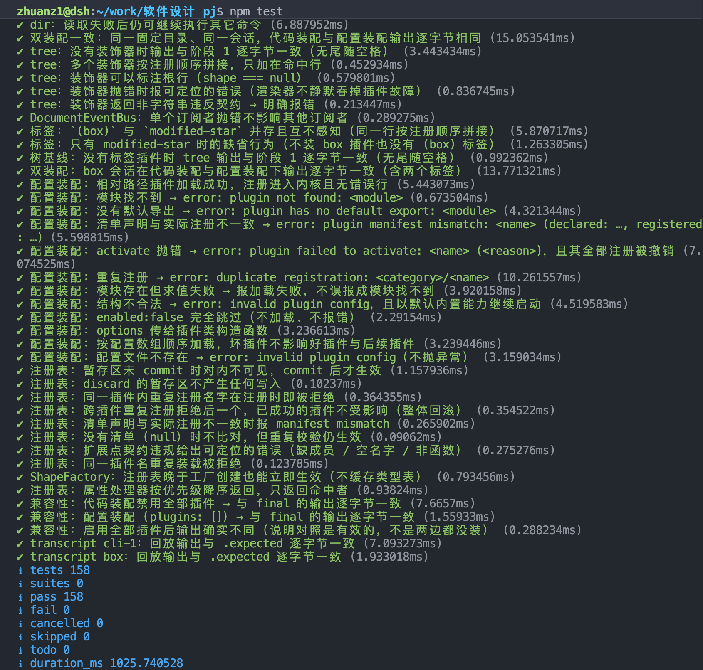
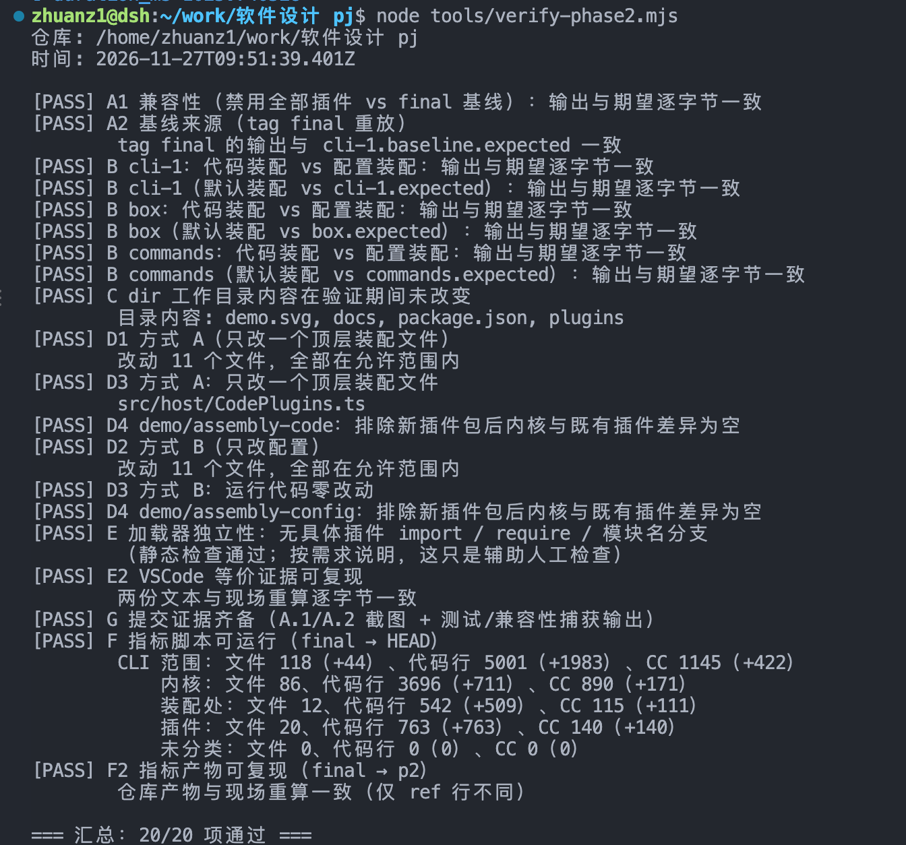
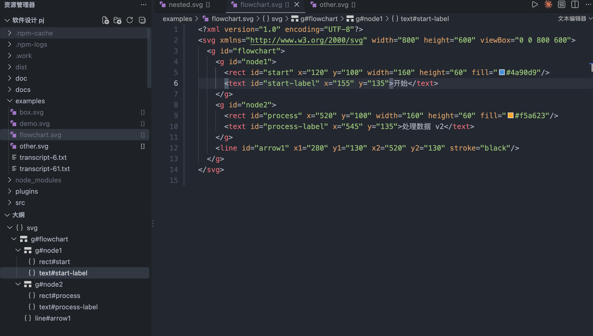

# SVG 编辑器（CLI + VSCode 扩展）— 阶段 2 设计文档

> **一句话**：阶段 1 解决"功能怎么实现"，阶段 2 解决"新功能装在哪里"——
> 内核只保留四个扩展点与一条统一的装配/校验路径，`box` 图形、`stats`/`dir` 命令、
> `modified-star`/`(box)` 树标签全部以**独立插件包**接入，内核与既有插件零改动。
> 另附一个 VSCode 扩展（资源管理器 `.svg` 标记 + 原生大纲）。

| 阶段 | 内容 | 证据 |
|---|---|---|
| 阶段 1（tag `final`） | CLI 编辑器：19 条命令、6 种图形、SVG 读写、undo/redo | [`doc/phase1-design.md`](phase1-design.md) |
| 阶段 2（tag `p2`，本文件） | 插件框架（4 扩展点 + 2 装配方式）、4 个插件、`dir` 适配器、VSCode 扩展（Part A） | `npm test`、`node tools/verify-phase2.mjs`、[`docs/metrics/report.md`](../docs/metrics/report.md) |

---

## 0. 交付物与快速开始

### 0.1 目录结构

```text
.
├── src/
│   ├── domain/        # 图形/文档/校验（零外部依赖）；ShapeProvider 扩展点定义
│   ├── plugin-api/    # ★阶段 2 新增：四个扩展点接口 + 注册表 + 插件上下文 + 文档事件
│   ├── commands/      # 编辑命令（Command 模式）；SetCommand 接入属性处理器
│   ├── ports/         # 文件存储/编解码端口
│   ├── io/            # SvgReader/SvgWriter/NodeFileStore（Adapter）
│   ├── app/           # EditorSession（门面，兼命令宿主 CommandHost）
│   ├── cli/           # REPL、命令表、三个 Presenter
│   ├── builtin/       # ★阶段 2 新增：内置图形/编辑命令也以插件形式装配
│   ├── host/          # ★阶段 2 新增：装配处（组合根、插件加载器、配置装配）
│   └── main.ts        # 只调用 runCliMain
├── plugins/           # ★阶段 2 新增：可选插件（npm workspaces，各自独立包/独立测试）
│   ├── stats/         #   stats 命令插件
│   ├── dir/           #   dir 命令插件（含 DirectoryReader 端口 + NodeDirectoryReader 适配器）
│   ├── shape-box/     #   box 复合图形插件（图形 + fill/label 属性语义 + (box) 树标签）
│   ├── tree-star/     #   modified-star 树标签插件
│   └── shape-diamond/ #   diamond 基本图形插件（可选拓展任务：只加一个 ShapeProvider）
├── vscode-extension/  # ★阶段 2 新增：Part A 的 VSCode 扩展（独立 npm 包、独立测试）
├── doc/               # 设计文档、ADR、依赖图、可执行会话契约、Part A（VSCode）
├── docs/metrics/      # ★由 tools/metrics/report.mjs 生成的指标产物（不得手填）
├── tools/             # 验收脚本与指标脚本
└── test/              # 内核测试 + 跨插件集成测试 + transcript 回放
```

### 0.2 常用命令

```bash
npm ci                            # 安装依赖（含 plugins/* 与 vscode-extension 的 workspaces）
npm test                          # 全部用例：内核 + 各插件包（node:test + tsx）
npm run typecheck                 # 内核 + 每个插件包分别 tsc --noEmit
npm run cli                       # 交互式 CLI（tsx 直跑 TS 源码；代码装配）
npm run cli -- --config plugins.config.json   # 同一份插件清单的配置装配
npm run build                     # 编译内核到 dist/（node dist/main.js 可运行）
node tools/verify-phase2.mjs      # 阶段 2 一键验收（含与 tag final 的兼容性对照）
node tools/metrics/report.mjs     # 重新生成 docs/metrics/report.md（final → 当前）
cd vscode-extension && npm run evidence   # 重新生成 doc/evidence/*.txt（徽标决策 + 大纲数据）
```

### 0.3 节点与 tag

- 过程节点是**普通提交/合并提交**，不打标签：节点 1 VSCode 实践 → 节点 2 插件框架 → 节点 3 命令插件 → 节点 4 `box` → 节点 5 树标签 → 节点 6 文档与验收。
- 只有最终提交带 annotated tag **`p2`**；阶段 1 的 tag `final` 保持不动（`git rev-parse final` 恒为阶段 1 提交）。

---

## 1. 插件框架：四个扩展点

### 1.1 扩展点清单

四个扩展点的接口都放在 `src/plugin-api/`（**只依赖 `domain`**，插件也因此只被允许依赖 `domain` + `plugin-api`）。
"内核调用点"一列给出真实代码位置，便于核对"框架真的在用它，而不是摆设"。

| 扩展点 | 接口（`src/plugin-api/`） | 内核调用点 | 内置实现 | 本阶段新增实现 | 不装插件时的行为 | 违约时的文案 |
|---|---|---|---|---|---|---|
| **`ShapeProvider`**<br>图形类型 | `src/domain/shape/provider/ShapeProvider.ts`：`typeName`、`svgTag`、`dataKind`、`creationAttributes`、`create(id, init)`、`afterChildren(shape)` | `src/domain/shape/ShapeFactory.ts`（按类型名/标签查表，经 `ShapeProviderLookup`）；`src/io/SvgReader.ts:59` 按标签取 Provider、`:119` 读回后调 `afterChildren` | 6 个（`rect`/`circle`/`ellipse`/`line`/`text`/`g`；根 `<svg>` 由 `CanvasShape` 承担，不需要 Provider） | `box` | `create box …` → `error: unknown shape type: box`；读入 `data-kind="box"` → `warning: unknown shape kind 'box', kept as plain g` 并降级为 `g` | `error: duplicate registration: shapes/box`（重名）；`error: plugin manifest mismatch: …`（清单不符）；`afterChildren` 抛错 → 整个 `read` 失败 |
| **`Command`**<br>命令 | `src/plugin-api/CommandContribution.ts`：`commandName`、`usage`、`summary`、`create(args, env) → { run(host) }` | `src/host/CommandSetup.ts:19` `createCommandRegistry()` 组装命令表（顺序：文档动作 → 插件命令 → 显示动作）；`src/cli/CommandRegistry.ts` 按名字分派；适配器 `src/cli/PluginCommandEntry.ts` | 10 个编辑命令（`src/builtin/BuiltinEditCommands.ts`，经 `EditCommandContribution`） | `stats`、`dir` | `error: unknown command: stats`（与阶段 1 的未知命令一致） | `error: duplicate registration: commands/stats`；缺 `usage`/`summary`/`commandName` → 契约错误（`error: plugin failed to activate: … (plugin contract violated: …)`） |
| **`TreeDecorator`**<br>树标签 | `src/plugin-api/TreeDecorator.ts`：`decoratorName`、`labelFor(ctx)`、`onDocumentEvent(event)` | `src/cli/presenter/TreePresenter.ts:84`（逐行调用、按注册顺序用空格拼接、异常折算文案）；`src/cli/action/TreeAction.ts` 把装饰器注入 `ActionContext`；`src/app/EditorSession.ts` 通过 `DocumentEventBus` 发事件 | 无（阶段 1 的树输出就是"没有装饰器"） | `box-type-label`（`(box)`）、`modified-star`（`*`） | `tree` 输出与阶段 1 **逐字节相同**（不追加空格） | `error: tree decorator failed: <name> (<reason>)`（抛异常或返回非字符串） |
| **`AttributeHandler`**<br>属性语义 | `src/plugin-api/AttributeHandler.ts`：`handlerName`、`priority`、`handles(target, attr)`、`apply(target, attr, value, changes)`；写操作统一走 `src/plugin-api/AttributeChanges.ts` | `src/commands/SetCommand.ts`（按 `priority` 降序选一个处理器；命中则整条 `set` 交它执行；失败回滚并**不写历史**） | 无（阶段 1 的白名单逻辑保留为"没有处理器命中"时的缺省路径） | `box-attributes`（`fill` → 内部矩形，`label` → 内部文字） | `set n1 label …` → `error: unknown attribute: label`（阶段 1 白名单行为） | `error: ambiguous attribute handler: label (box-attributes, other)`（最高优先级并列 → 拒绝而非按注册顺序取） |

### 1.2 哪些**不是**扩展点（有意为之）

需求只列出上述四个变化点，其余"看起来也常变"的东西本阶段**不**做成插件，理由一并记在这里，避免"框架过度抽象"：

| 内容 | 现状 | 为什么不做成扩展点 |
|---|---|---|
| `init`/`read`/`save`/`canvas`/`tree`/`show`/`help`/`undo`/`redo` 共 9 条**会话动作** | `src/host/SessionActions.ts` 里注册为"文档动作/显示动作"，由 `CommandSetup` 排在插件命令之前/之后 | 它们操作的是 `EditorSession` 的生命周期与 IO，属于**宿主**职责；插件拿到的 `CommandHost` 已经能读文档、能提交编辑，把会话动作也开放出去会破坏"文档只能经 session 替换"的不变式 |
| 画布尺寸、`undo`/`redo` 的栈策略 | `src/app/EditorSession.ts` + `src/commands/History.ts` | 属于内核契约（一个 `set` = 一个 undo 单元、IO 命令清空历史），做成插件会让"撤销语义"依赖装配顺序 |
| 输出格式（数字格式、树形符号、错误文案前缀） | `src/domain/NumberFormat.ts`、`src/cli/presenter/*` | 需求要求跨阶段**逐字节兼容**，这类格式一旦可插拔就无法保证契约稳定 |

### 1.3 注册与校验路径（同一套，两条装配方式共用）

```text
装配处（host）
 ├─ 方式 A：CodePlugins.ts → new XxxPlugin(options)            ┐
 └─ 方式 B：plugins.config.json → PluginModuleResolver 解析模块 ┘
                    │
                    ▼
        activatePlugin(plugin, registry, beginPlugin)          ← src/host/PluginActivation.ts:17
                    │
                    ├─ ① beginPlugin(name, contributes) 开一个暂存区（PluginStaging）
                    ├─ ② plugin.activate(staging)       所有 register* 只写暂存区
                    ├─ ③ registry.commit(staging)       跨插件查重 → 清单比对 → 并入内核
                    └─ ④ 任一步失败 → registry.discard(staging) + 打印 error: 文案，继续启动
```

三个关键性质（都有测试）：

1. **失败零残留**：花费在暂存区里的注册从未进入内核，失败插件不会留下半个扩展（`test/plugin/loader.test.ts` 的 `throws` 夹具先注册一个合法标签再抛错，断言注册表为空）。
2. **清单是硬约束**：`package.json` 的 `contributes` 与"实际注册的类别-名字集合"必须相等，否则 `plugin manifest mismatch`。校验发生在 **commit 时**，因此插件无法"先注册再改清单"绕过（ADR-4）。
3. **插件之间互不感知**：注册表只按"类别 + 名字"存贡献，一个插件看不到、也不会 import 另一个插件；`(box)` 标签只读 `Shape.typeName()`，`modified-star` 只比内容快照，两者协作完全靠公共契约。

### 1.4 内核怎样做到"不按名字枚举"

| 关注点 | 阶段 1（`final`） | 阶段 2 |
|---|---|---|
| 图形类型表 | `ShapeFactory` 里硬编码 6 个 Provider 的 `Map` | 注入 `ShapeProviderLookup`，`ShapeFactory` 只做"查表 + 校验"；查不到就是 `unknown shape type` |
| 命令表 | `CliMain` 里手工 new 19 条命令并硬编码名字 | `host/CommandSetup` 按"文档动作 → 插件命令 → 显示动作"装配 `CommandRegistry`，注册表里没有任何具体命令名 |
| `set` 的属性语义 | 一张白名单 + `switch` 到各个 `setXxx` | 属性处理器链（`AttributeChanges` 事务）优先；无命中才走阶段 1 白名单（保证兼容） |
| 树标签 | 不存在（`TreePresenter` 直接输出行） | 装饰器列表按注册顺序拼接；空列表时输出逐字节不变 |
| 读回校验 | 内建类型各自校验 | `ShapeProvider.afterChildren(shape)` 通用钩子：插件自己决定"读到什么才算合法" |

`rg` 抽查（需求 §6 的判据之一，`node tools/verify-phase2.mjs` 会自动跑同类检查）：

```bash
# 加载器目录里不应出现任何具体插件的名字/import/分支
rg -n "import|require|switch" src/host/ConfigAssembly.ts src/host/PluginModuleResolver.ts src/host/PluginActivation.ts src/host/PluginConfig.ts
# 期望：只有 node:fs/node:path/node:module 与内核自身模块；没有任何 '@svgframe/plugin-*'
```

---

## 2. 两种装配方式

同一条注册与校验路径（§1.3），入口有两个。两者**产出的注册结果完全相同**，因此 `npm run cli` 与
`npm run cli -- --config plugins.config.json` 跑同一份会话的输出逐字节一致（§2.5 有脚本证据）。

### 2.1 方式 A：改代码（组合根）

只有**一个**顶层装配文件需要动：`src/host/CodePlugins.ts`。

```ts
// src/host/CodePlugins.ts
import DirPlugin from '@svgframe/plugin-dir';
import ShapeBoxPlugin from '@svgframe/plugin-shape-box';
import StatsPlugin from '@svgframe/plugin-stats';
import TreeStarPlugin from '@svgframe/plugin-tree-star';
import type { PluginModule } from '../plugin-api/PluginContext.js';

export function optionalPlugins(): readonly PluginModule[] {
  return [
    new StatsPlugin(),
    new DirPlugin(),
    new ShapeBoxPlugin(),
    new TreeStarPlugin(),
  ];
}
```

接入一个新插件 = 在这里加 `import` + 加一行 `new XxxPlugin(options)`（若有 `options`，就是构造参数）。
`src/host/CliMain.ts` 只负责 `new CodeAssembly(optionalPlugins())`，不需要改。

### 2.2 方式 B：改配置（`plugins.config.json`）

```json
{
  "plugins": [
    { "module": "@svgframe/plugin-stats" },
    { "module": "@svgframe/plugin-dir" },
    { "module": "@svgframe/plugin-shape-box" },
    { "module": "@svgframe/plugin-tree-star" }
  ]
}
```

运行：`npm run cli -- --config plugins.config.json`（缺省不传 `--config` 就走方式 A）。

### 2.3 配置文件格式

| 字段 | 类型 | 必填 | 说明 |
|---|---|---|---|
| `plugins` | 数组 | 是 | 每项一个插件；**数组顺序 = 注册顺序**（决定树标签的拼接顺序） |
| `plugins[].module` | 字符串 | 是 | 模块名（`@scope/name`、包名）或**相对于配置文件所在目录**的路径（`./x/y.js`） |
| `plugins[].options` | 任意 JSON | 否 | 传给插件：默认导出是**类**时作为构造参数；是**实例**时忽略（不覆盖已有实例状态） |
| `plugins[].enabled` | 布尔 | 否 | `false` = 显式跳过（便于临时关闭某个插件而不删配置） |

加载细则：

- 相对路径以**配置文件所在目录**为基准（`ConfigAssembly` 里解析，测试用临时配置验证过）；
- 裸模块名用 `createRequire(import.meta.url).resolve()` 解析，因此 `plugins/*` 作为 npm workspaces 能被按包名找到；
- 默认导出可以是**类**（用 `new exported(options)` 实例化）或**普通对象/实例**（直接用）；
- 对象的 `contributes` 字段用"原型安全的包装"读取（不 `spread`），因此 class 实例的原型方法不会丢（这条是修复过的一个真实 bug，见 §5.2）。

### 2.4 加载失败：四条路径 + 回滚 + 继续启动

| 场景 | 输出（逐字） | 之后 |
|---|---|---|
| 模块解析不到 | `error: plugin not found: <module>` | 该插件跳过，其余继续 |
| 模块存在但求值抛错 | `error: plugin failed to activate: <module> (<reason>)` | 同上（**不会**误报成 "not found"） |
| 没有默认导出 | `error: plugin has no default export: <module>` | 同上 |
| 清单与实际注册不一致 | `error: plugin manifest mismatch: <name> (declared: …, registered: …)` | 暂存区丢弃，内核无残留 |
| `activate` 抛错 | `error: plugin failed to activate: <name> (<reason>)` | 同上 |
| 跨插件重名注册 | `error: duplicate registration: <category>/<name>` | 后一个插件整体不生效 |
| 配置文件结构不合法 | `error: invalid plugin config` | 以"没有可选插件"启动（内置 6 种图形与阶段 1 的 19 条命令仍在） |

对应测试：`test/plugin/loader.test.ts`（12 个用例，含 `enabled:false`、`options` 传递、注册顺序）。

### 2.5 双装配一致性的证据

```bash
$ node tools/verify-phase2.mjs
[PASS] A1 兼容性（禁用全部插件 vs final 基线）：输出与期望逐字节一致
[PASS] A2 基线来源（tag final 重放）：tag final 的输出与 cli-1.baseline.expected 一致
[PASS] B cli-1：代码装配 vs 配置装配：输出与期望逐字节一致
[PASS] B box：代码装配 vs 配置装配：输出与期望逐字节一致
[PASS] B commands：代码装配 vs 配置装配：输出与期望逐字节一致
[PASS] C dir 工作目录内容在验证期间未改变
[PASS] D1/D2/D3/D4 开闭原则判据（§3.4，两条演示分支 × 改动范围/内核差异）
[PASS] E 加载器独立性：无具体插件 import / require / 模块名分支
[PASS] E2 VSCode 等价证据可复现（doc/evidence/ 与现场重算逐字节一致）
[PASS] G 提交证据齐备（A.1/A.2 截图 + 测试/兼容性捕获输出）
[PASS] F 指标脚本可运行（final → HEAD）
[PASS] F2 指标产物可复现（final → p2）
=== 汇总：20/20 项通过 ===
```

三份会话输入在 `doc/transcript/`（`cli-1`、`box`、`commands`），期望输出与之一并提交，
因此"双装配一致"不是一次性人工结论，而是每次跑脚本都重新验证的契约；
A2 还会现取 `git archive final` 重放一遍，确认基线文件没有被手改过。

---

## 3. 架构

### 3.1 模块划分（阶段 2）

| 层 | 目录 | 职责 | 新增/变化 |
|---|---|---|---|
| 核心域 | `src/domain` | 图形、文档、属性校验、Provider 扩展点定义 | `ShapeProvider` 增加 `dataKind` 与 `afterChildren`；`ShapeFactory` 改为注入 `ShapeProviderLookup` |
| 扩展点层 | `src/plugin-api` | 四个扩展点接口、`PluginStaging`/`ContributionRegistry`、`AttributeChanges`、`DocumentEventBus`、`ShapeSnapshot`、错误类型 | **全新** |
| 命令层 | `src/commands` | `Command`（execute/undo）、`History`、`SetCommand` 接入属性处理器 | `SetCommand` 变复杂（优先级/事务/回滚），其余不变 |
| 端口/IO | `src/ports`、`src/io` | 文件与编解码端口；SVG 读写适配器 | `SvgReader` 增加 `afterChildren` 校验点 |
| 应用层 | `src/app` | `EditorSession`：文档替换/保存/编辑的唯一入口，兼 `CommandHost` | 增加事件发布与 `commitEdit` |
| 表现层 | `src/cli` | REPL、命令表、Presenter | `CommandRegistry` 改为吃"排好序的条目"；`TreePresenter` 支持装饰器 |
| 内置插件 | `src/builtin` | 6 个图形 Provider + 10 个编辑命令，以插件形式注册 | **全新**（代码来自阶段 1，改为贡献项） |
| 装配处 | `src/host`、`src/main.ts` | 组合根、加载器、配置装配、CLI 入口、会话动作 | **全新** |
| 可选插件 | `plugins/*` | 4 个独立插件包（各自 `package.json`/`tsconfig`/测试） | **全新** |

### 3.2 依赖矩阵（`test/architecture.test.ts` 强制执行）

| 模块 | 允许依赖 |
|---|---|
| `domain` | （无） |
| `plugin-api` | `domain` |
| `commands` | `domain`、`plugin-api` |
| `ports` | `domain` |
| `io` | `domain`、`ports` |
| `app` | `domain`、`commands`、`ports`、`plugin-api` |
| `cli` | `domain`、`commands`、`app`、`plugin-api` |
| `builtin` | `domain`、`commands`、`plugin-api` |
| `host` | 以上全部（**唯一**允许认识所有人的地方） |
| `main` | `host` |

守护测试还断言：目录无环、`node:` 内置模块只允许出现在 `io`/`host`、
**插件包只能由装配处（`host`）按包名引用**（内核与插件本身都不许 import 具体插件）。

### 3.3 重构前后的模块依赖图（PlantUML）

- 重构前（tag `final`）：[`doc/diagrams/architecture-before.puml`](diagrams/architecture-before.puml)
- 重构后（tag `p2`）：[`doc/diagrams/architecture-after.puml`](diagrams/architecture-after.puml)
- 阶段 1 的类级组件图（保留）：[`doc/diagrams/architecture.puml`](diagrams/architecture.puml)

关键差异：

1. 新增 `plugin-api` 层，把"可变点"集中成四个接口；`domain` 仍然零依赖，但不再硬编码类型表。
2. 新增**装配处** `host`：阶段 1 的 `main.ts` 是"手工 new 一切"的组合根，现在它退化成一行 `runCliMain(...)`，
   所有"认识全部实现"的知识集中在 `host`。
3. 插件是**叶子**：`plugins/*` 只依赖 `domain` + `plugin-api`，彼此不 import；`builtin` 与第三方插件同权（没有特权 API）。
4. 依赖方向没有出现环，也没有"插件反向依赖内核命令/CLI"的捷径——`test/architecture.test.ts` 会拦。

### 3.4 开闭原则的证据

设 `C` = "把 `box` 插件接入项目"的那次提交。同一个插件包，两种接入方式各演示一次，落在两条独立分支上：

| 分支 | 接入方式 | 提交 |
|---|---|---|
| `demo/assembly-code` | 改代码：`src/host/CodePlugins.ts` 加一行 | `feat(plugin): 接入 box 插件（方式 A：仅改一个顶层装配文件）` |
| `demo/assembly-config` | 改配置：`plugins.config.json` 加一项 | `feat(plugin): 接入 box 插件（方式 B：只改配置，运行代码一行不动）` |

```bash
# 方式 A
$ git diff --name-status demo/assembly-code^ demo/assembly-code
M	package-lock.json
A	plugins/shape-box/package.json
A	plugins/shape-box/src/BoxAttributesHandler.ts
A	plugins/shape-box/src/BoxProvider.ts
A	plugins/shape-box/src/BoxShape.ts
A	plugins/shape-box/src/BoxTypeLabelDecorator.ts
A	plugins/shape-box/src/index.ts
A	plugins/shape-box/test/box.test.ts
A	plugins/shape-box/test/support/FakePluginContext.ts
A	plugins/shape-box/tsconfig.json
M	src/host/CodePlugins.ts

# 排除新插件包后，内核与既有插件的差异（必须为空）
$ git diff --name-status demo/assembly-code^ demo/assembly-code -- \
    src/domain src/commands src/cli src/app src/io src/plugin-api src/builtin plugins/stats plugins/dir
（空）

# 方式 B
$ git diff --name-status demo/assembly-config^ demo/assembly-config
M	package-lock.json
M	plugins.config.json
A	plugins/shape-box/…（同上 9 个文件）

# 方式 B 的运行代码差异（必须为空）
$ git diff --name-status demo/assembly-config^ demo/assembly-config -- src/
（空）
```

| 允许的改动 | 说明 |
|---|---|
| `plugins/shape-box/**` | 新插件包本身（源码、`package.json`、`tsconfig`、自带测试） |
| `src/host/CodePlugins.ts`（方式 A） | **唯一**的顶层装配文件，加 2 行（import + 实例化） |
| `plugins.config.json`（方式 B） | **唯一**的配置改动，加 1 项 |
| `package-lock.json` | 依赖元数据：新增 `@svgframe/plugin-shape-box` 的 workspace 条目，**没有**新增任何第三方依赖 |

`node tools/verify-phase2.mjs` 的 D1–D4 四项会重新跑上述判据（分支不存在或改动越界都会 FAIL）。

### 3.5 本阶段新增的能力一览

| 能力 | 类型 | 插件包 | 关键测试 |
|---|---|---|---|
| `box` 复合图形（矩形 + 标题，`data-kind="box"`） | `ShapeProvider` | `plugins/shape-box` | `plugins/shape-box/test/box.test.ts`、`test/plugin/box.integration.test.ts` |
| `set <box> fill` / `set <box> label` | `AttributeHandler` | `plugins/shape-box` | `test/plugin/attributes.test.ts`、`box.integration.test.ts` |
| `(box)` 树标签 | `TreeDecorator` | `plugins/shape-box` | `test/plugin/labels.integration.test.ts` |
| `*` 未保存标记 | `TreeDecorator` | `plugins/tree-star` | `plugins/tree-star/test/modified-star.test.ts` |
| `diamond` 基本图形（可选拓展） | `ShapeProvider` | `plugins/shape-diamond` | `plugins/shape-diamond/test/diamond.test.ts` |
| `stats` 图形统计 | `Command` | `plugins/stats` | `plugins/stats/test/stats.test.ts`、`test/plugin/commands.test.ts` |
| `dir` 列当前目录 | `Command` + 适配器 | `plugins/dir` | `plugins/dir/test/*.test.ts`、`test/plugin/commands.test.ts` |

---

## 4. `dir` 的目录访问接口与适配器模式

### 4.1 三方角色

```text
DirCommand（客户端，只认识抽象）
      │  依赖
      ▼
DirectoryReader（Target/端口：plugins/dir/src/DirectoryReader.ts）
      ▲  实现
      ├── NodeDirectoryReader（Adapter：fs.readdirSync + statSync → DirectoryEntry[]）
      └── FakeDirectoryReader（测试替身：直接给定条目，不碰文件系统）
```

- **端口（Target）**：`DirectoryReader.read(target) → readonly DirectoryEntry[]`，`DirectoryEntry = { name, kind }`，
  `kind ∈ {'directory','file','other'}`；失败抛 `DirectoryReadError(target, reason)`。
- **适配器（Adapter）**：`NodeDirectoryReader` 把 `Dirent`/`Stats` 的语义翻译成展示语义，
  并把所有 `fs` 异常折算成带目标路径的 `DirectoryReadError`。
- **Adaptee**：`node:fs` 的 `readdirSync`/`statSync`（返回的是 `Dirent`，与"目录/文件/其它"的三分法并不对应）。

命令只依赖端口，因此"排序、分组、空目录、失败文案"这些**行为**可以完全脱离文件系统被验证
（`plugins/dir/test/dir.test.ts`），真实适配器另有一组用例（`node-adapter.test.ts`：临时目录、隐藏项、符号链接、非目录路径）。

### 4.2 语义细则

| 情况 | 行为 |
|---|---|
| 排序 | 目录在前、文件其次、`[OTHER]` 最后；每组按**码位**升序（不受 locale 影响，输出稳定可断言） |
| 隐藏项 | 照常列出（`.env`、`.gitignore` 都属于用户想知道的内容），不列 `.`/`..`（`readdirSync` 默认不含） |
| 符号链接 | 跟随一次 `stat` 判定目标类型（目录→`[DIR]`、文件→`[FILE]`）；目标不可读 → `[OTHER]`；**不递归**遍历 |
| 特殊项（FIFO/socket/设备） | `[OTHER]` |
| 空目录 | `(empty directory)` |
| 读取失败 | `error: cannot read directory: <path>`（REPL 打印后继续接受命令，不退出、不改文档、不进历史） |
| 未 `init`/`read` | 可用（`dir` 与文档无关）；此时文档类命令仍报 `error: no document` |
| 有文档时 | 不改变文档、不改变 dirty 状态、不进入 undo 栈（`test/plugin/commands.test.ts` 用 undo 反向验证） |
| 工作目录 | 缺省 `process.cwd()`；插件 `options.cwd` 可覆盖（测试与双装配一致性用它固定目录） |

### 4.3 为什么不在命令里直接 `readdirSync`

1. **可测性**：4 类边界（混合/空/隐藏/失败）与排序规则不必依赖真实文件系统，测试跑得快且不污染工作目录。
2. **可替换**：将来要列"最近打开文件"、远程目录、内存虚拟树，只需再写一个端口实现。
3. **职责**：命令关心"怎么展示"，适配器关心"文件系统怎么说"——`Dirent` 的 8 种判定方法与
   "目录/文件/其它"的三分法之间的翻译只存在于适配器一处。

---

## 5. 阶段 2 的过程记录（AI 生成 → 人工核对 → 修正）

### 5.1 需求逐条核对表

| 阶段 2 需求 | 实现位置 | 验证 |
|---|---|---|
| 四个扩展点各有真实调用点、有实现 | §1.1 表格 | `test/plugin/*`、`test/architecture.test.ts` |
| 内核不出现具体插件名/类型名 | `src/host/CommandSetup.ts`、`ShapeFactory` 注入查表、`SetCommand` 处理器链、`TreePresenter` 装饰器列表 | `node tools/verify-phase2.mjs` 的 E 项 + `rg` 抽查 |
| 禁用插件仍可启动且行为与阶段 1 相同 | `doc/transcript/plugins-none.config.json` | `test/transcript/baseline.test.ts`（与 tag `final` 输出逐字节相同） |
| `stats`（类型首次出现顺序、容器单列、box 内部叶子照常计） | `plugins/stats/src/StatsCounter.ts` | `plugins/stats/test/stats.test.ts` |
| `dir`（适配器、test double + 真实 fs、固定目录、日志在目录外） | `plugins/dir/src/*` | `plugins/dir/test/*.test.ts`、`tools/verify-phase2.mjs` C 项 |
| 两种装配方式、同一注册与校验路径 | `CodePlugins.ts` / `plugins.config.json` | `test/plugin/commands.test.ts`、`verify-phase2.mjs` B 项 |
| 四条失败路径 + 回滚 | `src/host/PluginModuleResolver.ts`、`PluginActivation.ts` | `test/plugin/loader.test.ts` |
| 清单校验与重复注册 | `src/plugin-api/ContributionRegistry.ts` | `test/plugin/registry.test.ts`、`loader.test.ts` |
| `box` 图形/属性语义/树标签、不变量、读回与降级 | `plugins/shape-box/src/*` | `plugins/shape-box/test/box.test.ts`、`test/plugin/box.integration.test.ts` |
| `modified-star` 与 `(box)` 并存、状态不串味 | `plugins/tree-star/src/ModifiedStarDecorator.ts` | 两个标签测试文件 |
| 开闭原则（两条演示分支 + 判据） | `demo/assembly-code`、`demo/assembly-config` | `verify-phase2.mjs` D 项 |
| 可选拓展：`diamond` 基本图形 | `plugins/shape-diamond/src/*` | `plugins/shape-diamond/test/diamond.test.ts` |
| 指标脚本化（内核/装配处/插件分开、扩展单列） | `tools/metrics/report.mjs` | `docs/metrics/report.md` 由脚本生成 |
| VSCode 扩展（徽标 + 原生大纲 + A.3 分析） | `vscode-extension/` | 见 §9 |

### 5.2 我改回的 AI 建议 / 修掉的真实 bug

阶段 2 的代码几乎全部是 AI 生成、我逐条核对的。下面每条都是**实际发生过**的偏差与修法（保留在提交历史里）：

| # | 现象 | 根因 | 修法 |
|---|---|---|---|
| 1 | 重构后 `help` 里 `tree/show/help/undo/redo` 跑到编辑命令后面 | 命令表改为"注册顺序即顺序"，插件命令先注册 | 引入 `host/CommandSetup.ts`：文档动作 → 插件命令 → 显示动作，恢复阶段 1 顺序；用 transcript 逐字节比对兜底 |
| 2 | 测试替身 Provider 查不到 `providerForTag` | 替身没实现 `dataKind`，查表返回 `undefined` | `ContributionRegistry.commit()` 统一归一为 `dataKind ?? null` |
| 3 | 类形态的插件"注册成功但没有 `activate`" | 清单回退用了对象展开 `{...plugin}`，原型方法不是自有属性 | 改为闭包包装 `{ name, contributes, activate: (ctx) => plugin.activate(ctx) }`（这就是"原型安全包装"存在的原因） |
| 4 | `set n1 label …` 的 undo 回显 `label=none`（应为旧值） | `AttributeChanges` 按**子部件属性名**（`text`）记录，回显按**命令参数名**（`label`）取旧值 | `AttributeChanges.firstBeforeAny()` 兜底，仍未命中才显示 `none` |
| 5 | `dir` 首版把整个列表当一行返回 | 命令返回 `string` 而不是 `string[]` | 改为逐行数组（REPL 逐行打印；测试与外部断言更清晰） |
| 6 | `<g id="n1" x="120" …>` 多出一份坐标 | `create box` 的几何参数经 `applyImportedAttributes` 漏进 `extras` | `BoxShape.applyImportedAttributes` 过滤已消费的 `x/y/width/height/data-kind` |
| 7 | 接入 `box` 后"双装配一致性"用例失败 | 测试里内联了一份插件清单，和 `plugins.config.json` 漂移 | 测试直接读仓库自带 `plugins.config.json`：清单漂移立刻红 |
| 8 | 演示分支误把 `examples/box.svg`（回放产物）提交进去 | `git add -A` 把工作区残留一起收了 | 验收脚本 D2 判据把它当"范围外改动"报出来，amend 修正；`examples/*.svg` 早已在 `.gitignore` |
| 9 | 同时跑多个测试文件偶发 `invalid plugin config` | 两个测试文件共用 `test/.tmp` 且其中一个删整个目录 | 每个测试文件用独立子目录（`test/.tmp/plugin-loader`、`test/.tmp/plugin-commands`） |
| 10 | 接入 `modified-star` 后 box 集成测试全红 | 集成测试用的是"默认装配"（含新标签），断言却没考虑 `*` | box 集成测试改为"只装 box 插件"，标签效果由 labels 集成测试覆盖 |

另外几条**"AI 建议、我裁定不采纳"**：

- AI 提议把 9 条会话动作（`init`/`read`/`save`/…）也做成 `Command` 插件 → 否决：它们操作 `EditorSession` 生命周期与 IO，属宿主职责（理由见 §1.2）。
- AI 提议读入 `box` 结构不合法时"降级为普通 `g` 并告警" → 否决：会把插件知识搬回内核，且用户以为在编辑 `box`（ADR-2）。
- AI 提议 `modified-star` 按"是否执行过编辑命令"记布尔标记 → 否决：`undo` 回到保存点后仍会亮星，与直觉不符（ADR-3）。

### 5.3 迭代与回归

| 节点 | 用例数 | 关键回归手段 |
|---|---|---|
| 阶段 1 完成（`final`） | 59 | transcript 逐字节 |
| 节点 2 框架 | 95 | 阶段 1 的 59 个用例 + 两份阶段 1 transcript 逐字节不变（指标脚本与并行子任务在节点 6 合并，见 §6.3 #11） |
| 节点 3 命令插件 | 119 | 未装插件时 `unknown command`；装上后 `help` 列出 |
| 节点 4 `box` | 136 | round-trip（`save`→`read`）与"未装插件降级" |
| 节点 5 树标签 | 152 | 状态机（编辑→保存→再编辑→undo 回保存点）+ 双装配一致 |
| 节点 6 文档+验收（含 diamond 拓展） | 158 | `node tools/verify-phase2.mjs` 全项通过 |

---

## 6. 一致性自查（阶段 2）

### 6.1 模块划分：方案与实际目录

§3.1 的表就是实际目录（`ls src` 可直接核对）。两处**有意**的偏离：

1. `plugin-api` 单独成层而不是塞进 `domain`：插件只允许依赖 `domain` + `plugin-api`，若混进 `domain`，
   插件就能顺手拿到 `ShapeFactory`/`SvgDocument` 的内部实现，"扩展点"的边界就没了。
2. `builtin` 不是 `domain` 的一部分：内置图形/命令也需要走注册表，这样"内置"与"第三方"同权，
   否则一旦地基走捷径，"新增图形零改动"就无法被证明。

### 6.2 依赖方向：规则有没有被违反

`test/architecture.test.ts` 把 §3.2 的矩阵写成可执行断言（含无环、`node:` 只用 `io`/`host`、
插件包只由 `host` 命名引用）。当前 0 违反；`main.ts` 只 import `host`。

### 6.3 与需求不一致 / 需求未规定处的裁定（如实记录）

| # | 需求 | 实现 | 说明 |
|---|---|---|---|
| 1 | §5 示例树写 `g#n1 (box)` | 实现为 `box#n1 (box)` | 需求 §3.1 的命名规则是 `类型#id`，`(box)` 只是类型标注；两者不应互相覆盖，故以 `box#n1` 为准 |
| 2 | §7.4 要求 `docs/metrics/`，而设计文档在 `doc/` | 指标按需求放 `docs/metrics/`，设计文档仍在 `doc/` | 两个目录并存是有意的（不改需求指定路径） |
| 3 | 只规定 `[DIR]`/`[FILE]` 两种标记 | 增加 `[OTHER]` | 符号链接/特殊项的兜底，§4.2 有说明 |
| 4 | `ungroup` 应拒绝 `box` | 拒绝，但文案是 `error: not a container: n1` | `box` 不是 `g`，内核按"非分组容器"拒绝；为保证"接入提交不改内核"，未改文案 |
| 5 | 未规定 `show <box>` 输出 | 只显示通用属性（`id`/`parent`/`children` 数） | `fill`/`label` 要看 `show n1-rect` / `show n1-label`；`show` 未做成扩展点（§1.2） |
| 6 | 重复 id "必须拒绝整个读入" | 对 `box` 子部件生效（`afterChildren` 拒绝）；其它元素仍沿用阶段 1 的"重命名 + 告警" | 改全局行为会破坏阶段 1 兼容性 |
| 7 | 未规定属性处理器多命中 | `priority` 降序取最高；最高并列 → 拒绝并报 `ambiguous attribute handler` | ADR-1 |
| 8 | 未规定祖先行是否标 `*` | 不传播（根行汇总） | ADR-3，与 §5 示例形态一致 |
| 9 | "可选拓展：diamond" | 以 `plugins/shape-diamond` 实现（只加一个 `ShapeProvider`） | §3.4 的 OCP 二次验证；装配在两条路径各加一行 |
| 10 | §3.3 给出的初始接口 `handles(shapeId, attr)` / `apply(shapeId, attr, value)` | 实现为 `handles(target: ShapeTarget, attr)` / `apply(target, attr, value, changes)` | 需求同段写明"具体接口和事务实现方式自行设计，须在文档中说明"；用 `ShapeTarget` 才能改子部件、用 `AttributeChanges` 才能保证"一次 set 一个 undo 单元"（ADR-1） |
| 11 | 节点 2 的状态含"`metrics` 首次产出" | 指标由并行子任务产出、在节点 6 合并（`tools/metrics/report.mjs` + `docs/metrics/`） | 如实记录：脚本与产物在节点 6 才进 main；`final → p2` 的数字见 §7.3，脚本每次运行可复现（验收脚本 F/F2） |

---

## 7. 质量保证

### 7.1 用例分布（每个插件包都能独立跑）

| 范围 | 用例数 | 命令 |
|---|---|---|
| 内核（`test/domain`、`test/commands`、`test/io`、`test/app`、`test/cli`、`test/architecture`） | 59 | `npm test` |
| 插件框架与跨插件集成（`test/plugin`） | 52 | `npm test` |
| 会话契约（`test/transcript`） | 3 | `npm test` |
| **合计（CLI + 插件）** | **158** | `npm test` |
| `@svgframe/plugin-stats` | 7 | `npm test --workspace @svgframe/plugin-stats` |
| `@svgframe/plugin-dir` | 12 | `npm test --workspace @svgframe/plugin-dir` |
| `@svgframe/plugin-shape-box` | 9 | `npm test --workspace @svgframe/plugin-shape-box` |
| `@svgframe/plugin-tree-star` | 8 | `npm test --workspace @svgframe/plugin-tree-star` |
| `@svgframe/plugin-shape-diamond` | 6 | `npm test --workspace @svgframe/plugin-shape-diamond` |
| VSCode 扩展 | 见 §9 | `cd vscode-extension && npm test` |

插件测试使用**测试替身**提供扩展上下文（`test/support/FakePluginContext.ts`）与外部协作者
（`FakeDirectoryReader`），因此不依赖其它插件、也不依赖文件系统。

### 7.2 可执行契约

- `doc/transcript/*.txt` + `*.expected`：输入只含命令，输出逐字节比对（`test/transcript/*`）。
- `doc/transcript/cli-1.baseline.expected`：tag `final` 的冻结输出，用于阶段 1 兼容性。
- `node tools/verify-phase2.mjs`：把"兼容性 / 双装配 / dir 固定目录 / OCP 判据 / 加载器独立性 / 指标"一次性跑完。

### 7.3 指标（`final → p2`）

见 [`docs/metrics/report.md`](../docs/metrics/report.md)（由 `node tools/metrics/report.mjs` 生成，
脚本同时产出 `report.json` 便于复核；数字不得手填）。复现：

```bash
node tools/metrics/report.mjs --from final --to p2     # 与仓库里的产物只差「目标 ref」那一行
node tools/metrics/report.mjs --selftest               # 口径自检（19 项）
```

本阶段的数字（`final → p2`，单位＝代码行「非空非注释」/ 圈复杂度 CC）：

| 分区 | 文件数 | 代码行 final → p2 | 代码行增量 | CC final → p2 | CC 增量 |
|---|---:|---:|---:|---:|---:|
| 内核（`domain`/`commands`/`ports`/`io`/`app`/`cli`/`plugin-api`） | 86 | 2985 → 3696 | **+711** | 719 → 890 | **+171** |
| 装配处（`host`/`main.ts`/`plugins.config.json`） | 12 | 33 → 542 | **+509** | 4 → 115 | **+111** |
| 插件（`builtin`/`plugins`） | 20 | 0 → 763 | **+763** | 0 → 140 | **+140** |
| **CLI 合计** | **118** | 3018 → 5001 | **+1983** | 723 → 1145 | **+422** |
| 测试（单列，不计入） | 43 | 1337 → 3164 | +1827 | 139 → 407 | +268 |
| VSCode 扩展（单列，不计入） | 19 | 0 → 1437 | +1437 | 0 → 252 | +252 |

三句话解读：

1. **内核增量里 90% 是新增的扩展点层**（`src/plugin-api`）+ `ShapeFactory`/`SvgReader`/`SetCommand`/`TreePresenter` 四个接缝；
   阶段 1 的 19 条命令、6 种图形的行为代码没有重写，只是从"硬编码"变成"注册表驱动"。
2. **装配处 +509 行**是一次的、与插件数量无关的开销（加载器 + 两条装配路径 + 命令表顺序）；每多一个插件只增加
   `CodePlugins.ts` 一行 / `plugins.config.json` 一项。
3. **插件 +763 行**是可选能力（`stats`/`dir`/`box`/`diamond`/`modified-star`），全部可以整包卸掉而不影响内核。

口径：

- **内核** = `src/domain`、`src/commands`、`src/ports`、`src/io`、`src/app`、`src/cli`、`src/plugin-api`
- **装配处** = `src/host`、`src/main.ts`、`plugins.config.json`
- **插件** = `src/builtin`、`plugins/**`（排除其测试与 `node_modules`）
- **VSCode 扩展** = `vscode-extension/**`（**单列**，不并入 CLI 差值）

### 7.4 类型与构建

- `tsc --noEmit`：内核 `strict` + `noUncheckedIndexedAccess` + `verbatimModuleSyntax`；每个插件包各自一份 `tsconfig.json`（继承根配置）。
- `npm run build` 产物 `dist/` 可用 `node dist/main.js` 直接跑（阶段 1 的用法不变）。

### 7.5 运行证据（真机截图 + 可复现日志）

作业要求提交「插件与加载器测试」「功能兼容性验证」「VSCode 扩展运行截图」三份证据，这里各给一份**真机截图**，
外加可原样重跑的文本日志（[`doc/evidence/`](evidence)，验收脚本 G 项核对齐备）。

**① 插件与加载器测试**（`zhuanz1@dsh:~/work/软件设计 pj$ npm test`，全量 158 用例）



*图 7-1：加载器四条失败路径（`plugin not found` / `no default export` / `manifest mismatch (declared: …, registered: …)` /
`failed to activate`，后者断言"其全部注册被撤销"）、重复注册 `duplicate registration: <category>/<name>`、
暂存区 `discard` 零写入、跨插件重复注册整体回滚、`box` 的事务/回滚、两个树标签并存等用例逐条通过；
末尾 `ℹ tests 158 / pass 158 / fail 0`。完整输出见 [`doc/evidence/plugin-loader-tests.txt`](evidence/plugin-loader-tests.txt)。*

**② 功能兼容性验证**（`node tools/verify-phase2.mjs`，20 项）



*图 7-2：A1/A2 用 tag `final` 的代码现场重放并按字节比对（阶段 1 行为未变）、B 三份会话在两种装配下逐字节一致、
*C `dir` 固定目录未被改动、D1–D4 开闭原则判据、E 加载器无具体插件依赖、E2 等价证据可复现、G 证据齐备、F/F2 指标可复现；
`=== 汇总：20/20 项通过 ===`。逐行说明见 [`doc/evidence/compatibility.txt`](evidence/compatibility.txt)。*

**③ VSCode 扩展运行截图**：见 [§9](#9-第一部分vscode-插件实践) 的图 A.1（`[]` 徽标）与图 A.2（原生大纲）。

---

## 8. 决策记录（ADR）

| ADR | 结论一句话 |
|---|---|
| [ADR-1 属性扩展点的调用契约与事务边界](adr/0001-attribute-handler-contract.md) | 处理器拿"目标视图"改子部件；`priority` 降序，最高并列即拒绝；`AttributeChanges` 是唯一 undo 单元；失败整体回滚且不写历史 |
| [ADR-2 `box` 的读回策略](adr/0002-box-readback-degradation.md) | `data-kind` 标类型；未装插件 → 降级 `g`；装了但结构不合法 → **拒绝整个读入**；子部件 id 派生 `<id>-rect`/`<id>-label` |
| [ADR-3 dirty 语义与祖先传播](adr/0003-dirty-semantics-and-ancestor-propagation.md) | 按内容与保存点比较（`undo` 回保存点星消失）；祖先不传播、根行汇总；标签按注册顺序空格拼接 |
| [ADR-4 插件清单校验时机与回滚](adr/0004-plugin-manifest-validation.md) | 暂存区 + 一次性 commit：跨插件查重 → 清单比对 → 并入；任一步失败整体丢弃，插件零残留 |

## 9. 第一部分：VSCode 插件实践
> 本部分代码在独立子包 [`vscode-extension/`](../vscode-extension/README.md)：有自己的 `package.json`、`tsconfig.json`、`node_modules`；
> 根包的 `scripts`、`src/`、`test/` **一行未改**，所以阶段 1 的 59 个用例与 VSCode 扩展互不影响。
> 本部分自身的门槛：`npm run typecheck`、`npm run build`、`npm test`（39 个用例）全绿，`npm run package` 可产出 VSIX。
>
> **截图（真机，见 [`doc/images/`](images/README.md)）**：A.1 与 A.2 各一张——
> [`images/vscode-badge.png`](images/vscode-badge.png)（`examples/` 下四个 `.svg` 带 `[]`，同目录的 `.txt` 与各文件夹**不带**）、
> [`images/vscode-outline.png`](images/vscode-outline.png)（`sample/nested.svg` 的嵌套大纲：无 id 的 `g`/`text` 只显示标签名，
> `<title>`/`<defs>` 也进大纲）。拍摄环境：macOS 本地 VSCode 打开本仓库（OrbStack 虚拟机共享目录），VSIX 装在本地扩展宿主。
> 本仓库的开发容器没有 `code` CLI / Xvfb / 浏览器运行库，拍不了图，所以**先**用真实扩展代码生成了可复现的**等价证据**：
> [`doc/evidence/vscode-badge.txt`](evidence/vscode-badge.txt)（徽标决策表：哪些 Uri 得到 `[]`、哪些连 `stat` 都不发、两段式刷新各触发几次）与
> [`doc/evidence/vscode-outline.txt`](evidence/vscode-outline.txt)（`DocumentSymbol` 的层级、`range`/`selectionRange`、编辑到一半时清空而非崩溃）。
> 两者由 `vscode-extension/tools/evidence.ts` 生成、`npm run evidence` 可复现，验收脚本 E2 项核对未被手改；G 项核对证据齐备。

> **另两份「运行证据」（真机捕获，非截图）**：
> [`doc/evidence/plugin-loader-tests.txt`](evidence/plugin-loader-tests.txt) —— 插件框架/加载器用例与 5 个插件包各自的 `npm test` 输出，含四条失败路径与重复注册回滚的用例名；
> [`doc/evidence/compatibility.txt`](evidence/compatibility.txt) —— 功能兼容性验证：现取 `git archive final` 重放同一份 `cli-1.txt`，与阶段 2（禁用全部插件）输出 `diff` 为空、`sha256` 相同（`f1617…8979`），再附 20 项验收脚本输出。
> 两份都可按文件内记录的命令原样重跑。

### 9.1 交付物与运行方式

| 交付物 | 位置 | 说明 |
|---|---|---|
| 扩展清单 | [`vscode-extension/package.json`](../vscode-extension/package.json) | `main: dist/extension.js`、`activationEvents: ["onStartupFinished"]`、`engines.vscode: ^1.75.0`；脚本 `build`/`typecheck`/`test`/`package` |
| 入口 | [`src/extension.ts`](../vscode-extension/src/extension.ts) | `activate` 装配并注册；`deactivate` 不持有全局状态（注册项交给 `context.subscriptions`） |
| 组合根 | [`src/app/ExtensionBootstrap.ts`](../vscode-extension/src/app/ExtensionBootstrap.ts) | 造两个 Provider、经端口注册，对应 Phase 1 `src/main.ts` 的位置 |
| 文件装饰（A.1） | [`src/decoration/`](../vscode-extension/src/decoration) | `SvgFileDecorationProvider` + `SvgDecorationJudge` + `FacadeFileKindProbe` + `DecorationMark` |
| 原生大纲（A.2） | [`src/outline/`](../vscode-extension/src/outline) | `SvgOutlineProvider` + `OutlineParser` + `OutlineElement` + `LineIndex` |
| VSCode 外观端口 / 绑定 | [`src/ports/VscodeLike.ts`](../vscode-extension/src/ports/VscodeLike.ts)、[`src/vscode/VscodeBinding.ts`](../vscode-extension/src/vscode/VscodeBinding.ts) | 全包只有 `VscodeBinding` 在运行时 `require('vscode')` |
| 示例 SVG | [`sample/nested.svg`](../vscode-extension/sample/nested.svg) | 嵌套 `<g>`；带 id（`g#layer1`、`rect#bg`）与不带 id（`g`、`text`）的元素；另有 `defs/title/linearGradient` 这类非图形元素 |
| 安装 / 启动文档（A.3） | [`vscode-extension/README.md`](../vscode-extension/README.md) | F5 调试、`vsce package` → 装 VSIX、Remote 场景在远端安装 |
| 测试 | [`test/`](../vscode-extension/test) | Node 内置 test runner + tsx，39 个用例，全部用假 VSCode 外观驱动 |

运行三步（详见扩展 README）：`npm install` → `npm run build` → F5；或 `npm run package` 得到 `svg-marker-outline.vsix` 后 `code --install-extension`。

**A.1 / A.2 需求逐条核对**（每条都能指到代码或测试）：

| 需求原文要点 | 落地情况 | 证据 |
|---|---|---|
| `.svg` 文件旁显示 `[]` 标记 | ✅ | `DecorationMark.BADGE = '[]'`；`SvgFileDecorationProvider.provideFileDecoration()` |
| 标记不修改文件名 / 文件内容 | ✅ | 只用 `FileDecoration`（视图附加信息）；扩展不写文件，代码里没有任何 `fs.write`/`WorkspaceEdit` |
| 非 SVG 文件不加标记 | ✅ | `SvgDecorationJudge.mark()` 先判后缀，非 `.svg` 直接返回、连 `stat` 都不发；用例「非 SVG 文件不加标记，也不会去 stat」 |
| 目录不加标记 | ✅ | `FacadeFileKindProbe` 读 `FileType` 位标志；用例「目录不加标记（即使名字以 .svg 结尾）」 |
| 原生 Outline 展示根元素 / 容器 / 叶子 | ✅ | `SvgOutlineProvider` 返回层级化 `DocumentSymbol[]`（`children` 表达嵌套） |
| 有 id 显示 `标签名#id`，无 id 显示标签名 | ✅ | `OutlineElement.label()`；用例「嵌套分组」「无 id 元素」 |
| 点击节点定位到相应源代码 | ✅ | `range` 覆盖整个元素、`selectionRange` 覆盖起始标签；用例「range 覆盖整个元素、selectionRange 覆盖起始标签」 |
| 编辑内容后大纲更新 | ✅ | VSCode 每次文档变更重新调用 provider，插件全量重算；用例「编辑更新：…新增/删除/改 id/移动节点」 |
| XML 不完整允许暂时清空，但不得崩溃 | ✅ | `OutlineParser.parse()` 返回 `[]`（不抛错）+ Provider `try/catch` 兜底；用例「不完整 XML（5 类）」「逐字符截断全量扫一遍」 |
| 测试至少覆盖嵌套分组 / 无 id / 编辑更新 / 不完整 XML | ✅ | `test/outlineParser.test.ts` + `test/outlineProvider.test.ts`（见 §七 表格） |
| 不要求完整 SVG 规范校验 / 图形预览 | ✅ | 只扫结构，不校验；无渲染代码 |



*图 A.1：资源管理器里 `examples/` 下四个 `.svg` 右侧显示 `[]`；同目录的 `transcript-6.txt`、`transcript-61.txt` 与各文件夹没有徽标，
文件名本身未被改动。右侧 `flowchart.svg` 的大纲选中 `text#start-label`，编辑器高亮第 6 行——徽标与大纲是两件独立的事，互不影响文件内容。*

### 9.2 A.1 文件标记：Explorer 里的 `[]`

**做法**：`vscode.window.registerFileDecorationProvider` + `FileDecoration.badge = '[]'`。徽标是**视图附加信息**，不改进程里的文件名，也不写回文件内容。

| 环节 | 代码 | 关键事实 |
|---|---|---|
| VSCode 询问 | `SvgFileDecorationProvider.provideFileDecoration(uri)` | 签名是**同步**的（不能返回 Promise），Explorer 每次绘制都可能问 |
| 后缀判定 | [`SvgDecorationJudge.mark()`](../vscode-extension/src/decoration/SvgDecorationJudge.ts) | `uri.path.toLowerCase().endsWith('.svg')`；不是 `.svg` 直接 `undefined`，**连 `stat` 都不发** |
| 类型探测 | [`FacadeFileKindProbe.kindOf()`](../vscode-extension/src/decoration/FacadeFileKindProbe.ts) → [`VscodeBinding.fileTypeOf()`](../vscode-extension/src/vscode/VscodeBinding.ts) | `vscode.workspace.fs.stat` 的 `type` 是**位标志**（`File=1`、`Directory=2`、`SymbolicLink=64`），必须按位判断，不能 `===` |
| 徽标 | [`DecorationMark.svg()`](../vscode-extension/src/decoration/DecorationMark.ts) → `new vscode.FileDecoration('[]', tooltip)` | `badge` 硬上限 2 字符，需求要的 `[]` 正好 2 个 |

**为什么判定不能"一问了之"（本部分最核心的一个取舍）**：

```text
Explorer: provideFileDecoration(uri)           插件: 后缀是 .svg 但类型未知 → undefined（这一帧先不标）
                                              ↓ 后台 workspace.fs.stat（异步）
                                              ↓ 结论写入缓存
Explorer: onDidChangeFileDecorations(uri) ←──── 只有"加不加标记"真的变了才 fire
Explorer: provideFileDecoration(uri)           插件: 命中缓存 → '[]'
```

* 若不放行两段式，就只能把"后缀是 .svg 的目录"也打上标记——需求明确要求目录不加标记，而**同步 API 拿不到"这是不是目录"**。
* 若每次都 `stat`，Explorer 滚动一次就会把同一路径问几十遍；所以结论按 `uri.toString()` 缓存，并用 `probing` 集合合并并发探测（`SvgDecorationJudge` 里两个容器分工）。
* `stat` 失败（文件被删、无权限、路径不存在）按"非文件"处理并缓存：宁可少一个标记，也不要每次重绘都重发失败请求。
* 刷新只在"加不加标记"变化时发：目录 / 探测失败从"未知"变成"不加"，**没有可见变化就不 fire**，避免无谓重绘。

**踩到的坑（都已写进代码注释与扩展 README）**：

| 坑 | 现象 | 本工程的处理 |
|---|---|---|
| 激活时机 | 不写 `activationEvents` 时，扩展要等命令/语言事件才激活，而 Explorer 早就画完了，结果"没有标记，直到重载窗口" | `activationEvents: ["onStartupFinished"]`：启动完成即注册 Provider |
| `badge` 长度 | 超过 2 字符会被 VSCode 静默丢弃/截断 | 只用 `[]`，并在 `DecorationMark` 里做成常量 |
| 目录与目录竞态 | 名字以 `.svg` 结尾的目录也会被问；异步探测回来前收集不到信息 | 两段式 + 缓存 + 只在实际变化时刷新 |
| 删除/重命名后缓存陈旧 | 缓存只按 `uri.toString()` 记，文件没了标记还在 | 明确记录为已知限制；标记本身无副作用，重载即恢复 |
| 其他装饰扩展共存 | 同一个 Uri 只能显示一份装饰结果 | 本扩展不修改文件名/内容，也不假设与其他装饰扩展的优先级 |

### 9.3 A.2 原生大纲：层级、`标签名#id`、点击定位

**做法**：`vscode.languages.registerDocumentSymbolProvider(选择器, provider)`，返回**层级化** `DocumentSymbol[]`（嵌套用 `children`，而不是扁平的 `SymbolInformation[]`——扁平结构表达不了 `<g>` 套 `<g>`）。

| 大纲要求 | 实现 | 说明 |
|---|---|---|
| 根元素 / 容器 / 叶子 | `SvgOutlineProvider.toSymbol()` 递归 | 元素树直接来自 `OutlineParser`，`<svg>` 是根，其余按是否有子元素分容器/叶子 |
| 显示 `标签名#id` | `OutlineElement.label()` | 有 `id` → `g#layer1`；无 `id` → `g`（**绝不臆造 id**，这点与 Phase 1 的模型相反，见 §六） |
| 点击定位到源码 | `range` 覆盖整个元素，`selectionRange` 只覆盖起始标签 | VSCode 要求 `selectionRange ⊆ range`；点击时它跳 `selectionRange`，因此光标落在 `<g id="layer1">` 上而不是元素末尾 |
| 编辑后更新 | 不监听任何事件 | VSCode 在文档每次变更后**重新调用** `provideDocumentSymbols`，插件每次全量重算（结构简单、无缓存一致性风险） |
| 不完整 XML 不崩 | `OutlineParser.parse()` 返回 `[]`；`SvgOutlineProvider` 再包一层 `try/catch` | 需求允许"暂时清空大纲"，但不允许扩展抛错。两道防线：解析器自己吞掉结构异常，Provider 兜住任何意外异常 |

**为什么选择器写成 `{ pattern: '**/*.svg' }`（不带 `scheme`、不带 `language`）**：

* `.svg` 在 VSCode 里可能被识别为 `xml`、`plaintext`，或被别的扩展改成自定义 language id——依赖 `language` 选择器会漏文件；
* Remote-SSH / Dev Container 窗口里文件 Uri 的 scheme 是 `vscode-remote`，写死 `scheme: 'file'` 会让大纲在远端窗口**完全不出现**；
* 只用 `pattern` 是模式的超集：本地、远端、`untitled` 都命中，且不会误伤 `x.svg.txt`。

**解析器为什么自己写（与 XmlParser 的关系见 §六）**：[`OutlineParser`](../vscode-extension/src/outline/OutlineParser.ts) 是一个 150 行左右的"只服务大纲"的容错扫描器：

| 输入 | 结果 | 理由 |
|---|---|---|
| 完整 `<svg>…</svg>` | 层级树 + 每个元素的 `[start, tagEnd]` 与 `[start, end]` 偏移 | 定位需要字符偏移，VSCode 只认 Position，`LineIndex` 负责换算（O(n) 建表 + O(log n) 查询，CRLF 也正确） |
| 未闭合元素 / 标签不匹配 / 多余的 `</g>` | `[]` | 半截树上的"范围"不可信，点过去会跳到奇怪位置 |
| 注释/CDATA/指令未闭合 | `[]` | 同上是"正在输入"状态 |
| 有注释、`<?xml?>`、`<!DOCTYPE>`、CDATA | 正常解析，不产生伪节点 | 这些是真实文件里必然出现的东西 |
| 未知标签（`defs`、`path`、`title`、`linearGradient`…） | 照样显示 | 大纲描述"文件里有什么"，不是"模型认识什么" |
| 嵌套 > 256 层 | `[]` | 与 Phase 1 `XmlParser.MAX_DEPTH` 同口径的防御上限 |
| 属性值里出现 `>` | 不截断标签 | 找 `>` 时跳过引号内内容 |
| 空文件 / 纯文本 / 只有注释 | `[]` | 没有可展示的结构，不算错误 |


*图 A.2：`vscode-extension/sample/nested.svg` 的原生大纲——真实嵌套（`svg → defs → linearGradient#sky → stop…`、`g#layer1 → g → circle#sun`）、
无 id 元素只显示标签名（`g`、`text`，不臆造 id）、非图形元素（`title`/`defs`）也照样进大纲；选中 `circle#sun` 时编辑器定位到对应源码行。*

### 9.4 A.3-1 VSCode 与插件的职责，以及"注册 → 调用"过程

**职责划分**（一句话：VSCode 提供"事件 + 视图 + 协议"，插件提供"判断 + 数据"）：

| 维度 | VSCode 负责 | 插件负责 |
|---|---|---|
| 事件源 | 文件系统扫描、Explorer 绘制、文档打开/编辑/关闭、光标 | 不监听、不轮询——没有一行 `onDidChangeTextDocument` 或文件监听 |
| 视图 | Explorer 的徽标渲染、Outline 面板的树控件、图标、折叠 | 只提供数据：`FileDecoration`（badge + tooltip）、`DocumentSymbol`（name/kind/range/selectionRange/children） |
| 协议 | 定义 `FileDecorationProvider` / `DocumentSymbolProvider` 的接口与方法签名 | 实现这些接口；方法**同步或异步返回数据**，不控制渲染 |
| 调度 | 什么时候问、问几遍、问哪些 Uri、多久刷新一次 | 单次询问必须给出结果（所以要把异步探测做成"先答没有、随后通知重问"） |
| 生命周期 | `activate` / `deactivate`、`context.subscriptions` 的释放 | 在 `activate` 里注册，注册项一律包成 `Disposable` 交出 |
| 状态 | 不替插件保存任何东西 | 自己决定缓存（`SvgDecorationJudge` 的 `decided`/`probing`） |

**注册过程（`activate` 做的事，编号即调用顺序）**：

1. VSCode 扩展宿主在"启动完成"时触发 `onStartupFinished`，加载 `dist/extension.js` 并调用 `activate(context)`；
2. `activate` 造 `new VscodeBinding()`（把 VSCode API 适配成 `VscodeLike` 端口）；
3. `new ExtensionBootstrap(binding).activate()`：
   * `registerFileDecorationProvider(new SvgFileDecorationProvider(...))` → 内部 `vscode.window.registerFileDecorationProvider({ provideFileDecoration, onDidChangeFileDecorations })`；
   * `registerDocumentSymbolProvider({ pattern: '**/*.svg' }, new SvgOutlineProvider(...))` → 内部 `vscode.languages.registerDocumentSymbolProvider(...)`；
4. 两个注册返回的 `Disposable` 被塞进 `context.subscriptions`——窗口关闭/扩展停用时 VSCode 逐个 `dispose()`，插件不需要自己写清理逻辑（`VscodeBinding` 里额外把 `EventEmitter` 一起释放）。

**调用过程（VSCode 主动、插件被动，插件不"推"数据）**：

```text
用户                  VSCode                                        插件
 |  打开 Explorer  ---> 扫描工作区，绘制每个可见项
 |                      |-- provideFileDecoration(uri) -------------> SvgDecorationJudge.mark()
 |                      |<-- undefined / FileDecoration --------------  （未知就先返回 undefined 并后台 stat）
 |                      |<-- onDidChangeFileDecorations(uri) ---------  探测完成且结论变化
 |                      |-- provideFileDecoration(uri) -------------> 命中缓存 → '[]'
 |
 |  双击 a.svg     ---> 打开文档，按选择器匹配 **/*.svg
 |                      |-- provideDocumentSymbols(document) -------> OutlineParser.parse() → DocumentSymbol[]
 |                      |<-- DocumentSymbol[] ------------------------  （层级树）
 |                      |   渲染 Outline 面板
 |  点大纲节点      ---> 用 selectionRange 定位光标（编辑器滚动到该行）
 |  键入一个字符    ---> 文档变更 → 重新 provideDocumentSymbols → 全量重算 → 面板更新
```

**三点结论**：

* 这是**控制反转**：插件不调用视图 API、不持有视图对象，只实现回调；谁调用、调用几次、什么时候调用全由 VSCode 决定。因此每个回调都必须是"幂等、可重复、无副作用"的纯查询。
* 因为回调可以随时发生，插件**不能假设调用顺序**：`provideFileDecoration` 可能在 `activate` 之前排队的绘制里被调用，也可能对已经不存在的文件调用——所以判定函数把"探测失败"当成正常分支。
* 相对的，插件**唯一的一次"主动"**是 `onDidChangeFileDecorations`：它等价于告诉 VSCode "我的答案变了，再问我一次"。整个扩展里没有第二处主动推送（大纲更新完全靠 VSCode 自己重问）。

### 9.5 A.3-2 文件装饰 vs 经典 Decorator / Adapter

**先给结论**：文件装饰**借用了 Decorator 的"意图"与命名，但结构不是 Decorator**；本工程里真正落地的模式是 **Adapter**（而且是三个不同方向的适配），以及一个**回调式 Provider（控制反转/好莱坞原则）**。

#### 5.1 与经典 Decorator 的对照

| 结构要素 | 经典 Decorator（GoF） | 本工程的文件装饰 |
|---|---|---|
| 被装饰者 | 一个对象 | 没有对象被包装：Uri 还是 Uri，`fs.stat` 还是 `fs.stat` |
| 装饰者 | 实现**与被装饰者相同的接口**，持有被装饰者的引用并转发调用 | `FileDecoration` 与被装饰者（Uri）**不共享任何接口**，也不持有 Uri |
| 组合方式 | 运行期 `new Border(new Scroll(new Text()))` 链式包起来 | **旁挂**：`(uri → decoration)` 的映射，由 Explorer 在渲染时按需查询 |
| 客户端感知 | 客户端只看到接口，装饰是透明的 | 客户端（Explorer）明确知道自己在"额外问一次装饰"，并单独渲染徽标 |
| 叠加性 | 可以任意层叠，行为逐层累积 | 不能链式累积：同一 Uri 只有一份装饰结果；刷新靠事件而不是包装链 |
| 生命周期 | 与对象同生共死 | 每次绘制都可能重新询问；缓存责任在插件，且必须自己失效 |
| 共同点 | **不改主体、附加显示信息**；`FileDecoration.propagate` 甚至能让装饰"传播到子项"，这一点确实很像树上的装饰 | 同 |

所以：**"Decorator" 在这里是 UI 语汇（装饰外观），不是模式实现**。VSCode 没有给我们"包装 Explorer 条目对象"的机会，它给的是一个"查询点"（provider）+ 一个"值对象"（`FileDecoration`）。真正的机制描述是：

> **旁挂值对象 + 回调式 Provider + Observer 式的失效通知**（`onDidChangeFileDecorations`）。

工程上的含义很实在：因为不能包装，所以**状态必须自己管**（缓存、并发合并、失效）；如果它是真正的 Decorator，这些责任会落在被包装对象上，插件一行缓存都不用写。

#### 5.2 与 Adapter 的对照：本工程里 Adapter 出现在三个方向

| 适配器 | 角色 | 被适配者 → 目标接口 | 与经典 Adapter 的对应/差异 |
|---|---|---|---|
| [`VscodeBinding`](../vscode-extension/src/vscode/VscodeBinding.ts) | **对象适配器**（组合，不继承） | 具体 `vscode` 命名空间 → [`VscodeLike`](../vscode-extension/src/ports/VscodeLike.ts) 端口 | 对应。差异：经典 Adapter 是为"复用一段不改动的旧代码"而生，这里的目的更偏向**隔离易变的外部 API + 让上层可在纯 Node 下测试**（六边形架构里的 outbound adapter） |
| [`FacadeFileKindProbe`](../vscode-extension/src/decoration/FacadeFileKindProbe.ts) | **数据语义适配** | `FileType` 位标志（`1/2/64`）→ `'file' / 'directory' / 'unknown'` 三态 | 对应"转换表示"的 Adapter 变体；差异：它把"位运算细节"藏起来，避免 `FileType` 常量泄漏进判定逻辑（否则 `SvgDecorationJudge` 就依赖 VSCode 了） |
| [`SvgOutlineProvider`](../vscode-extension/src/outline/SvgOutlineProvider.ts) + `createDocumentSymbol` | **数据表示适配**（入站） | `OutlineElement[]`（带字符偏移）→ `DocumentSymbol[]`（带 Position/Range/kind） | 对应。差异：经典 Adapter 的客户端是业务代码；这里"客户端"是 VSCode 自己，插件是被调用方（入站 adapter），所以适配发生在**返回值的构造**上，而不是方法调用转发上 |
| [`SvgFileDecorationProvider`](../vscode-extension/src/decoration/SvgFileDecorationProvider.ts) | 同上（入站） | `DecorationMark` → `vscode.FileDecoration` | 同上 |

这两个"入站适配器"有一个共同点，也是本工程的关键取舍：**端口用的是"结构镜像"而不是 VSCode 的类**（`DocumentSymbolLike`/`FileDecorationLike`），真实类只在 `VscodeBinding` 里 `new` 出来。代价是绑定处要两次断言（`vscode.FileDecoration` 的可选字段 vs 端口的必填字段；`DocumentSymbol.children` 的元素类型），收益是 39 个用例全部不依赖 VSCode 运行时；断言都写在同一处并有注释说明理由。

#### 5.3 一句话总结

* **意图层面**：文件装饰 = 经典 Decorator 的"不改主体、附加显示"。
* **结构层面**：不是 Decorator（无同接口包装、无转发链），而是"旁挂值对象 + Provider 回调 + 失效事件"。
* **真正用到的模式**：Adapter（三个方向）+ Facade（`ExtensionBootstrap` 装配门面）+ Ports & Adapters 的依赖倒置；另外 Provider 形态本身是**控制反转**，与 Phase 1 的 Command/Composite 是互补的：**Phase 1 把"动作"封装成对象（谁来做由调用方决定），本部分把"数据"封装成回调（何时做由框架决定）**。

### 9.6 A.3-3 阶段 1 的解析 / 模型 / 遍历代码能否复用

结论先摆出来：**解析器、模型、遍历三层都没有直接 import 复用；复用的是"算法策略"，并且我把"能不能直接 import"逐条核实到了行号**。

| Phase 1 模块 | 能否直接复用 | 依据（具体到文件与行） | 如果硬复用会发生什么 |
|---|---|---|---|
| [`src/io/xml/XmlNode.ts`](../src/io/xml/XmlNode.ts) | ❌ | 字段只有 `name`、`attributeEntries`、`contentParts`（`XmlNode.ts:5–10`），**没有任何源码位置**；大纲的 `range`/`selectionRange` 完全没素材 | 要么放弃点击定位，要么在解析器外面再扫一遍源码"对齐"结构——解析逻辑变两份，偏移与结构一旦不一致就是错位的节点 |
| [`src/io/xml/XmlParser.ts`](../src/io/xml/XmlParser.ts) | ❌（技术上可 import，见右） | 零 Node 依赖（只 import `EditorError`/`XmlNode`），esbuild 能内联进 `dist/extension.js`，**技术上完全可行**；但它在 14 处直接 `throw new EditorError(...)`（如 `XmlParser.ts:105–107` 的 `unexpected/mismatched closing tag`、`:90` 的 `unclosed element`、`:194` 的 `unterminated attribute value`），且 `parse()` 只返回根节点、丢弃 `position` 变量（`:17`） | 编辑到一半时（连按几个字符就会出现未闭合标签）每一次按键都会抛异常；虽然 `try/catch` 能退化成空大纲（需求也允许），但**同样输入下我们本来就还能给出可信的部分结构**，没必要自我阉割 |
| [`src/io/SvgReader.ts`](../src/io/SvgReader.ts) | ❌ | ① 它读的是**模型**不是文件结构：`for (const child of root.children())`（`SvgReader.ts:46–48`）直接跳过根 `<svg>`，画布由 `CanvasShape` 顶替；② [`assignId()`](../src/io/SvgReader.ts#L118) 给无 id 元素**分配** id 并告警（`assigned id rect1 to unnamed <rect>`）→ 大纲会显示 `rect#rect1`，违反"无 id 只显示标签名"；③ 未支持标签被丢弃并告警（`SvgReader.ts:59–63`），而大纲必须显示 `defs/path/title/linearGradient`；④ 容错策略相反：文本展平（`:88–94`）、`transform` 忽略（`:74–76`）、缺失尺寸补 800×600（`:39–40`）——这些是"规范化"，大纲要"照抄文件" | 大纲与源文件对不上：不存在的 id、消失的元素、点击跳到错位置 |
| [`src/domain/shape/Shape.ts`](../src/domain/shape/Shape.ts) 及 6 个 `ShapeProvider` | ❌（格式一致，语义不一致） | `Shape.label()` 恰好就是 `标签名#id`（`Shape.ts:53–56`），这是唯一"格式对得上"的点；但它依附于"**一定有 id**"的模型，且 `Shape` 携带几何语义（`move`/`scale`/属性白名单/`snapshotGeometry`）——大纲一个都不用；`ShapeFactory` 只注册 6 个 provider（`rect/circle/ellipse/line/text/g`），而 SVG 有几十个标签 | 为无 id 元素造假 id，或把整个几何模型拖进扩展（体积、依赖方向、VSIX 里的死代码） |
| `ContainerShape.children()` / `SvgDocument.locate()` / `TreePresenter` 的遍历 | ❌ | `ContainerShape` 遍历的是模型子节点（`children(): readonly Shape[]`），`SvgDocument.locate()` 靠 **id** 定位（`SvgDocument.ts:38–60`）；大纲的坐标系是**字符偏移**，两套坐标不能互换（见 §三） | 需要把"偏移"塞回模型，或反过来在 CLI 里维护偏移——两边都被污染 |
| [`src/domain/EditorError.ts`](../src/domain/EditorError.ts) | ❌ | 大纲没有"给用户看的单行错误"这一出口：任何结构异常都退化成空大纲 | 引入 `domain` 依赖方向（扩展本可以完全不依赖根包） |
| `src/cli/**`（`Tokenizer`/`Repl`/`Presenter`） | ❌ | 那是"文本进、文本出"的 CLI 通道；本部分是 GUI 事件驱动，没有任何可用接缝 | — |

**那到底复用了什么？** 复用的是**算法策略**（不是代码文件）：

| 复用的东西 | 出处 | 在本部分的落点 |
|---|---|---|
| "找标签结束要跳过引号内的 `>`" | `XmlParser.findTagEnd()`（`:118–137`） | `OutlineParser.findTagEnd()` 同思路 |
| 跳过 `<?…?>`、`<!--…-->`、`<![CDATA[…]]>`、`<!DOCTYPE …>` | `XmlParser.parse()`（`:30–53`） | `OutlineParser.skipMarkup()` |
| 256 层嵌套上限的防御思路 | `XmlParser.MAX_DEPTH`（`:11`） | `OutlineParser.MAX_DEPTH` |
| "一类一文件、端口在 `ports/`、组合根装配"的分层纪律 | Phase 1 §1.1 | 本部分的 `ports/VscodeLike.ts`、`app/ExtensionBootstrap.ts`、`vscode/VscodeBinding.ts` |
| `标签名#id` 的展示格式 | `Shape.label()`（`Shape.ts:54`） | `OutlineElement.label()`（同样的字符串形状，重新实现的领域语义） |

**为什么不"把源文件复制进扩展目录"**：需求明确禁止；工程上也确实有害——两份解析器会各自演化（比如 Buffer 处理、命名空间、HTML 实体），而扩展的 tsconfig 与根包不同（`module: CommonJS` + VSCode 的 Node 版本），复制过来的文件一旦被 IDE 自动整理或格式化就会漂移；`vscode-extension` 是独立可发布的子包，不该依赖 `../src` 的相对路径（VSIX 里没有 `../src`）。

**如果将来要真的复用，应该改哪里**（这部分是"评估"的落点，不只是"不复用"）：

1. 给 `XmlNode` 加两个字段 `startOffset`/`endOffset`，`XmlParser.parse()` 在读写 `position` 时把它们填上——这样大纲就能直接 `import { XmlParser } from '../src/io/xml/XmlParser.js'`（唯一障碍消失）；
2. 给 `parse()` 加一个 `tolerate: boolean` 选项（或在 `EditorError` 之外再抛一个"可恢复"的子类），把 14 处 `throw` 改成"记下不可信位置、继续/停止"；
3. 把 `XmlParser`/`XmlNode` 抽成根包的独立 `packages/svg-xml`（当前是单包 + 子包），两边各带自己的 tsconfig 引用它——这才是"复制"之外的正确共享方式。

在这三条落地之前，**"策略复用 + 独立 150 行实现"是诚实的取舍**：不假装复用，也不为了复用去改 Phase 1 的已验证代码（根包的 59 个用例不该为阶段 2 第一部分承担回归风险）。

### 9.7 本部分的质量保证与已知限制

| 测试文件 | 覆盖的需求点 | 用例数 |
|---|---|---|
| [`test/outlineParser.test.ts`](../vscode-extension/test/outlineParser.test.ts) | 嵌套分组、无 id 元素、偏移量（range/selectionRange 的素材）、注释/CDATA/DOCTYPE、属性里的 `>`、未知元素、**不完整 XML（5 类）**、空文件、逐字符截断不崩、深嵌套上限、多根元素 | 15 |
| [`test/outlineProvider.test.ts`](../vscode-extension/test/outlineProvider.test.ts) | 层级化 `DocumentSymbol`、kind 映射、`range`/`selectionRange` 的行列、**编辑更新（新增/删除/改 id/移动节点/插入空行）**、不完整 XML → 空、坏→好恢复、CRLF、解析器异常兜底 | 10 |
| [`test/decoration.test.ts`](../vscode-extension/test/decoration.test.ts) | **非 SVG 不加标记且不 stat**、**目录不加标记**、首次无标记+探测后加标记+触发一次刷新、缓存不重复探测、并发合并、`.SVG` 大小写、Remote scheme、探测失败、取消订阅、`[]` 格式、`FileType` 位标志（含符号链接）、Provider 翻译 | 12 |
| [`test/activation.test.ts`](../vscode-extension/test/activation.test.ts) | 注册了两个 Provider、选择器形态（无 `language`、无 `scheme`）、dispose 清空、端到端产出大纲与徽标、重复调用无残留状态 | 5 |

* 测试只依赖 Node 内置 runner + tsx，**不装 `@vscode/test-electron`**（本机无图形环境），VSCode 一侧由 [`test/support/FakeVscode.ts`](../vscode-extension/test/support/FakeVscode.ts) 充当；
* 真机冒烟：`dist/extension.js` 用一份桩 `vscode` 模块跑通（`activate` 注册 2 项、徽标从 `undefined` → `[]`、目录即便叫 `folder.svg` 也不打标记、大纲 5 层嵌套的 `range`/`selectionRange` 都是真实 `Range`/`DocumentSymbol` 实例）——这验证了 `VscodeBinding` 的两次断言在运行期是安全的；
* `npm run package` 产出的 VSIX 只含 `package.json`/`readme`/`dist/extension.js`/`sample`，不含源码与测试（`.vscodeignore` 显式声明）。

已知限制（与扩展 README 同一份清单）：徽标 2 字符上限；首次看到某文件时可能晚一拍；删除/重命名后缓存陈旧；不完整 XML 时大纲清空；不做 SVG 规范校验与图形预览。

本部分做出的假设（若与验收口径不符，改起来都是局部改动）：

1. **选择器不写 `scheme: 'file'`**，改用 `{ pattern: '**/*.svg' }`——为了 Remote 窗口可用（需求要求写 Remote 安装说明，写死 `scheme` 会让该说明失效）；
2. **不完整 XML 一律返回空大纲**（需求允许"暂时清空"），不做"半截树"；
3. **不主动监听文档变化**，完全依赖 VSCode 重新调用 `provideDocumentSymbols`（每次全量重算，代价可接受：150 行扫描 + O(n) 行索引）；
4. 徽标 tooltip 用 `SVG 文件（svg-marker-outline）`；多个根元素时按多个顶层节点展示（编辑中的容错）。


---

## 附录 A：CLI 输出约定（阶段 2 增量）

阶段 1 的完整输出约定见 [`doc/phase1-design.md`](phase1-design.md) 附录 A；本阶段只增补以下内容：

### A.1 `stats`

```text
rect: 3  circle: 1  text: 1  (total 5, containers 1)
(total 0, containers 0)                      # 空文档
```

- 叶子按**类型首次出现顺序**列出（不是字母序），容器（`g`、`box`）不计入类型统计，只计 `containers`；
- 根 `svg` 不计入 `containers`（画布不是图形）；
- `box` 内部的矩形/文字照常按叶子计数，`box` 自身计入 `containers`；
- 只读命令：不进入 undo 栈、不改变 dirty 状态。

### A.2 `dir`

```text
[DIR]  docs
[DIR]  plugins
[FILE] demo.svg
[FILE] package.json
```

- 目录在前、文件其次、`[OTHER]` 最后，各组按码位升序；隐藏项照列；空目录输出 `(empty directory)`；
- 每项一行（REPL 逐行打印）。

### A.3 树标签

```text
svg (800x600) *
└── g#flowchart
    ├── box#n1 (box)
    │   ├── rect#n1-rect   x=120 y=100 w=160 h=60 fill=#f5a623 *
    │   └── text#n1-label  (140,135) "处理数据"
    └── line#arrow1  (280,130) -> (520,130)
```

- 标签追加在行尾，多个标签用**一个空格**连接，顺序 = 注册顺序（当前是 `(box)` 在内核里先注册、`*` 在后）；
- 没有装饰器时不追加任何字符（阶段 1 输出逐字节不变，无尾随空格）；
- `*` 语义见 ADR-3：内容与上次保存点不一致（根行汇总整个文档）。

### A.4 `diamond`（可选拓展）

```text
create diamond <id> <x> <y> <width> <height>
# 序列化为合法 SVG：<polygon points="上 右 下 左"/>
# 读回时由 points 反算外接矩形，属性回显使用 x/y/width/height（points 只是序列化形式）
```

### A.5 `box` 的创建与属性

```text
create box <id> <x> <y> <width> <height> ["<label>"]
set <boxId> fill <color>        # 落在内部矩形 <id>-rect
set <boxId> label "<text>"      # 落在内部文字 <id>-label
```

`tree` 里 `box` 行不显示内联几何（几何属于内部矩形行）；`move`/`scale` 作用于整体（两个子部件一起动）。

## 附录 B：错误信息清单（阶段 2 增量）

| 场景 | 文案 |
|---|---|
| 未知图形类型 | `error: unknown shape type: <type>` |
| 未装插件时 `create box` | `error: unknown shape type: box` |
| 未装插件读回 `data-kind` | `warning: unknown shape kind 'box', kept as plain g` |
| `box` 结构不合法（读回） | `error: invalid box <id>: expected <id>-rect and <id>-label, got [<ids>]` / `error: invalid box <id>: expected 2 parts, got <n>` |
| 删除 `box` 必要子部件 | `error: cannot remove required part of box: <id>` |
| 往 `box` 里塞第三个/错误子部件 | `error: cannot add child to box <id>: expected <a> / <b>, got <id>` / `… wrong type for <id>` |
| 新增子树 id 冲突 | `error: id already exists: <id>`（`create box` 的子部件冲突也走这条） |
| 属性处理器并列 | `error: ambiguous attribute handler: <attr> (<names>)` |
| 属性处理器失败 | 处理器原始错误（文档整体回滚，历史不变） |
| 树装饰器失败 | `error: tree decorator failed: <name> (<reason>)` |
| 插件未找到 / 求值失败 / 无默认导出 / 清单不符 / `activate` 失败 / 重名 / 配置非法 | 见 §2.4 |
| 未知命令（未装插件） | `error: unknown command: <name>` |

## 附录 C：阶段边界（阶段 2 明确不做）

- 不做插件的**热插拔/热卸载**（配置变更需重启 CLI）；
- 不做插件的**权限/沙箱**（同进程加载，信任仓库内插件）；
- 不做**远程插件仓库/版本解析**（`module` 只支持包名与相对路径，无版本约束求解）；
- 不做 VSCode 扩展与 CLI 的**数据联动**（扩展只做"文件标记 + 大纲"，不调用 CLI）；
- 不改阶段 1 的**输出契约**（容器/计数/数字格式/错误前缀一律沿用）。

## 附录 D：阶段 1 文档入口

阶段 1 的完整设计文档（架构方案、设计模式落地、依赖规则、过程记录、一致性自查、附录 A/B/C）
存档在 [`doc/phase1-design.md`](phase1-design.md)，对应 tag `final`。
