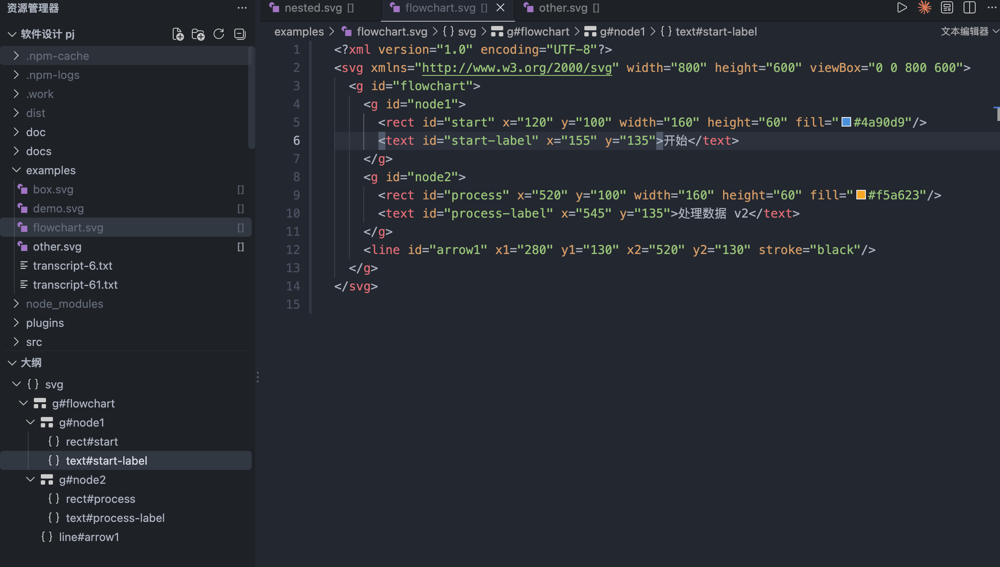
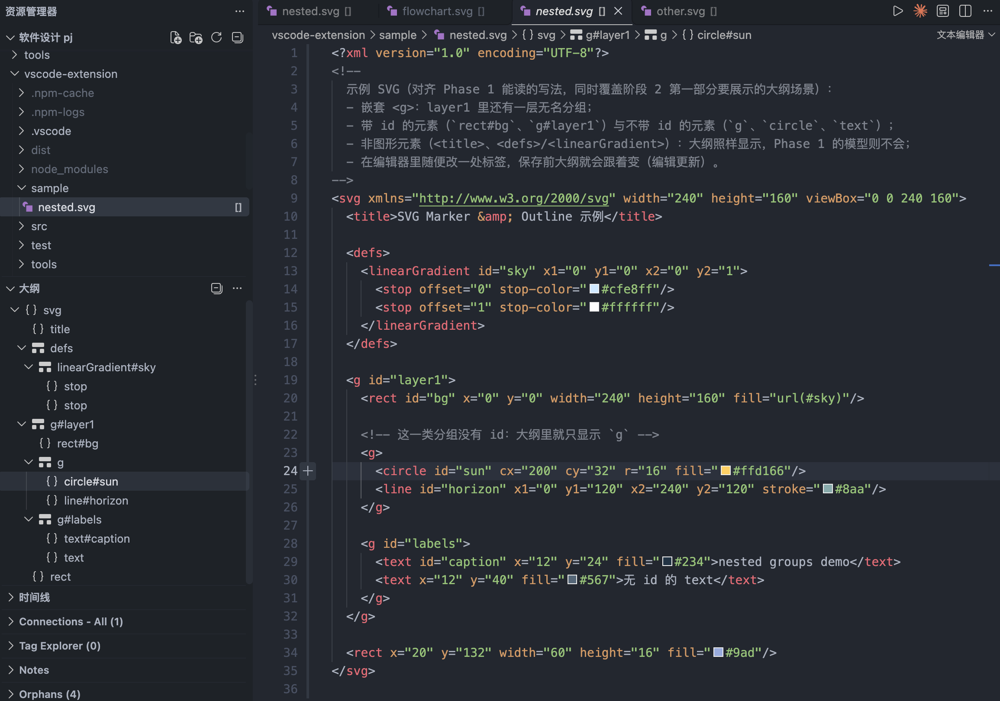

# 阶段 2 第一部分：VSCode 插件实践（Part A 章节草稿）

> 本章节是**草稿**，供主 `doc/README.md` 合并用（合并时作为一个一级章节 `## 第一部分：VSCode 插件实践` 追加到文档末尾）。
> 代码在独立子包 `vscode-extension/`：有自己的 `package.json`、`tsconfig.json`、`node_modules`；**根包的 `scripts`、`src/`、`test/` 一行未改**，Phase 1 的 59 个用例与本部分互不影响。
> 本部分的门槛：`npm run typecheck`、`npm run build`、`npm test`（39 个用例）全绿；`npm run package` 可用 `@vscode/vsce` 产出 `svg-marker-outline.vsix`。
>
> **截图说明**：本机没有 `code` CLI / Xvfb，无法启动 Extension Development Host 或 Remote 窗口，因此**没有生成任何截图**（也不提交占位图片）。下面两处路径为预留位置，**截图由用户在 VSCode Remote 中安装 VSIX 后拍摄**并放入 `doc/images/`：
>
> * `doc/images/vscode-badge.png`：Explorer 中 `.svg` 文件旁的 `[]` 徽标（含一个同名 `.svg` 目录与一个 `.md` 文件作为"无标记"对照）；
> * `doc/images/vscode-outline.png`：打开 `.svg` 后左侧原生「大纲」面板的层级树，以及点击某节点后光标落在起始标签上的瞬间。
>
> 两张图的相对引用已写在正文对应位置（`images/vscode-badge.png` / `images/vscode-outline.png`，即合并后的 `doc/images/…`）。

<!-- 合并提示：以下内容从 `## 第一部分：VSCode 插件实践` 开始，整段复制即可，无需再改编号。 -->

## 第一部分：VSCode 插件实践

> 阶段 2 第一部分（A.1 文件标记 / A.2 原生大纲 / A.3 分析与文档）。代码在独立子包 [`vscode-extension/`](../vscode-extension/README.md)：有自己的 `package.json`、`tsconfig.json`、`node_modules`，**根包的 `scripts`、`src/`、`test/` 一行未改**，所以 Phase 1 的 59 个用例与本部分互不影响。
> 本部分自身的门槛：`npm run typecheck`、`npm run build`、`npm test`（39 个用例）全绿。

### 一、交付物与运行方式

| 交付物 | 位置 | 说明 |
|---|---|---|
| 扩展清单 | [`vscode-extension/package.json`](../vscode-extension/package.json) | `main: dist/extension.js`、`activationEvents: ["onStartupFinished"]`、`engines.vscode: ^1.75.0`；脚本 `build`/`typecheck`/`test`/`package` |
| 入口 | [`src/extension.ts`](../vscode-extension/src/extension.ts) | `activate` 装配并注册；`deactivate` 不持有全局状态（注册项交给 `context.subscriptions`） |
| 组合根 | [`src/app/ExtensionBootstrap.ts`](../vscode-extension/src/app/ExtensionBootstrap.ts) | 造两个 Provider、经端口注册，对应 Phase 1 `src/main.ts` 的位置 |
| 文件装饰（A.1） | [`src/decoration/`](../vscode-extension/src/decoration) | `SvgFileDecorationProvider` + `SvgDecorationJudge` + `FacadeFileKindProbe` + `DecorationMark` |
| 原生大纲（A.2） | [`src/outline/`](../vscode-extension/src/outline) | `SvgOutlineProvider` + `OutlineParser` + `OutlineElement` + `LineIndex` |
| VSCode 外观端口 / 绑定 | [`src/ports/VscodeLike.ts`](../vscode-extension/src/ports/VscodeLike.ts)、[`src/vscode/VscodeBinding.ts`](../vscode-extension/src/vscode/VscodeBinding.ts) | 全包只有 `VscodeBinding` 在运行时 `require('vscode')` |
| 示例 SVG | [`sample/nested.svg`](../vscode-extension/sample/nested.svg) | 嵌套 `<g>`；带 id（`g#layer1`、`rect#bg`）与不带 id（`g`、`text`）的元素；另有 `defs/title/linearGradient` 这类非图形元素 |
| 安装 / 启动文档（A.3） | [`vscode-extension/README.md`](../vscode-extension/README.md) | F5 调试、`vsce package` → 装 VSIX、Remote 场景在远端安装 |
| 测试 | [`test/`](../vscode-extension/test) | Node 内置 test runner + tsx，39 个用例，全部用假 VSCode 外观驱动 |

运行三步（详见扩展 README）：`npm install` → `npm run build` → F5；或 `npm run package` 得到 `svg-marker-outline.vsix` 后 `code --install-extension`。

**A.1 / A.2 需求逐条核对**（每条都能指到代码或测试）：

| 需求原文要点 | 落地情况 | 证据 |
|---|---|---|
| `.svg` 文件旁显示 `[]` 标记 | ✅ | `DecorationMark.BADGE = '[]'`；`SvgFileDecorationProvider.provideFileDecoration()` |
| 标记不修改文件名 / 文件内容 | ✅ | 只用 `FileDecoration`（视图附加信息）；扩展不写文件，代码里没有任何 `fs.write`/`WorkspaceEdit` |
| 非 SVG 文件不加标记 | ✅ | `SvgDecorationJudge.mark()` 先判后缀，非 `.svg` 直接返回、连 `stat` 都不发；用例「非 SVG 文件不加标记，也不会去 stat」 |
| 目录不加标记 | ✅ | `FacadeFileKindProbe` 读 `FileType` 位标志；用例「目录不加标记（即使名字以 .svg 结尾）」 |
| 原生 Outline 展示根元素 / 容器 / 叶子 | ✅ | `SvgOutlineProvider` 返回层级化 `DocumentSymbol[]`（`children` 表达嵌套） |
| 有 id 显示 `标签名#id`，无 id 显示标签名 | ✅ | `OutlineElement.label()`；用例「嵌套分组」「无 id 元素」 |
| 点击节点定位到相应源代码 | ✅ | `range` 覆盖整个元素、`selectionRange` 覆盖起始标签；用例「range 覆盖整个元素、selectionRange 覆盖起始标签」 |
| 编辑内容后大纲更新 | ✅ | VSCode 每次文档变更重新调用 provider，插件全量重算；用例「编辑更新：…新增/删除/改 id/移动节点」 |
| XML 不完整允许暂时清空，但不得崩溃 | ✅ | `OutlineParser.parse()` 返回 `[]`（不抛错）+ Provider `try/catch` 兜底；用例「不完整 XML（5 类）」「逐字符截断全量扫一遍」 |
| 测试至少覆盖嵌套分组 / 无 id / 编辑更新 / 不完整 XML | ✅ | `test/outlineParser.test.ts` + `test/outlineProvider.test.ts`（见 §七 表格） |
| 不要求完整 SVG 规范校验 / 图形预览 | ✅ | 只扫结构，不校验；无渲染代码 |



### 二、A.1 文件标记：Explorer 里的 `[]`

**做法**：`vscode.window.registerFileDecorationProvider` + `FileDecoration.badge = '[]'`。徽标是**视图附加信息**，不改进程里的文件名，也不写回文件内容。

| 环节 | 代码 | 关键事实 |
|---|---|---|
| VSCode 询问 | `SvgFileDecorationProvider.provideFileDecoration(uri)` | 签名是**同步**的（不能返回 Promise），Explorer 每次绘制都可能问 |
| 后缀判定 | [`SvgDecorationJudge.mark()`](../vscode-extension/src/decoration/SvgDecorationJudge.ts) | `uri.path.toLowerCase().endsWith('.svg')`；不是 `.svg` 直接 `undefined`，**连 `stat` 都不发** |
| 类型探测 | [`FacadeFileKindProbe.kindOf()`](../vscode-extension/src/decoration/FacadeFileKindProbe.ts) → [`VscodeBinding.fileTypeOf()`](../vscode-extension/src/vscode/VscodeBinding.ts) | `vscode.workspace.fs.stat` 的 `type` 是**位标志**（`File=1`、`Directory=2`、`SymbolicLink=64`），必须按位判断，不能 `===` |
| 徽标 | [`DecorationMark.svg()`](../vscode-extension/src/decoration/DecorationMark.ts) → `new vscode.FileDecoration('[]', tooltip)` | `badge` 硬上限 2 字符，需求要的 `[]` 正好 2 个 |

**为什么判定不能"一问了之"（本部分最核心的一个取舍）**：

```text
Explorer: provideFileDecoration(uri)           插件: 后候？未知 → 返回 undefined（这一帧没徽标）
                                              ↓ 后台 workspace.fs.stat（异步）
                                              ↓ 结论写入缓存
Explorer: onDidChangeFileDecorations(uri) ←──── 只有"加不加标记"真的变了才 fire
Explorer: provideFileDecoration(uri)           插件: 命中缓存 → '[]'
```

* 若不放行两段式，就只能把"后缀是 .svg 的目录"也打上标记——需求明确要求目录不加标记，而**同步 API 拿不到"这是不是目录"**。
* 若每次都 `stat`，Explorer 滚动一次就会把同一路径问几十遍；所以结论按 `uri.toString()` 缓存，并用 `probing` 集合合并并发探测（`SvgDecorationJudge` 里两个容器分工）。
* `stat` 失败（文件被删、无权限、路径不存在）按"非文件"处理并缓存：宁可少一个标记，也不要每次重绘都重发失败请求。
* 刷新只在"加不加标记"变化时发：目录 / 探测失败从"未知"变成"不加"，**没有可见变化就不 fire**，避免无谓重绘。

**踩到的坑（都已写进代码注释与扩展 README）**：

| 坑 | 现象 | 本工程的处理 |
|---|---|---|
| 激活时机 | 不写 `activationEvents` 时，扩展要等命令/语言事件才激活，而 Explorer 早就画完了，结果"没有标记，直到重载窗口" | `activationEvents: ["onStartupFinished"]`：启动完成即注册 Provider |
| `badge` 长度 | 超过 2 字符会被 VSCode 静默丢弃/截断 | 只用 `[]`，并在 `DecorationMark` 里做成常量 |
| 目录与目录竞态 | 名字以 `.svg` 结尾的目录也会被问；异步探测回来前收集不到信息 | 两段式 + 缓存 + 只在实际变化时刷新 |
| 删除/重命名后缓存陈旧 | 缓存只按 `uri.toString()` 记，文件没了标记还在 | 明确记录为已知限制；标记本身无副作用，重载即恢复 |
| 其他装饰扩展共存 | 同一个 Uri 只能显示一份装饰结果 | 本扩展不修改文件名/内容，也不假设与其他装饰扩展的优先级 |

### 三、A.2 原生大纲：层级、`标签名#id`、点击定位

**做法**：`vscode.languages.registerDocumentSymbolProvider(选择器, provider)`，返回**层级化** `DocumentSymbol[]`（嵌套用 `children`，而不是扁平的 `SymbolInformation[]`——扁平结构表达不了 `<g>` 套 `<g>`）。

| 大纲要求 | 实现 | 说明 |
|---|---|---|
| 根元素 / 容器 / 叶子 | `SvgOutlineProvider.toSymbol()` 递归 | 元素树直接来自 `OutlineParser`，`<svg>` 是根，其余按是否有子元素分容器/叶子 |
| 显示 `标签名#id` | `OutlineElement.label()` | 有 `id` → `g#layer1`；无 `id` → `g`（**绝不臆造 id**，这点与 Phase 1 的模型相反，见 §六） |
| 点击定位到源码 | `range` 覆盖整个元素，`selectionRange` 只覆盖起始标签 | VSCode 要求 `selectionRange ⊆ range`；点击时它跳 `selectionRange`，因此光标落在 `<g id="layer1">` 上而不是元素末尾 |
| 编辑后更新 | 不监听任何事件 | VSCode 在文档每次变更后**重新调用** `provideDocumentSymbols`，插件每次全量重算（结构简单、无缓存一致性风险） |
| 不完整 XML 不崩 | `OutlineParser.parse()` 返回 `[]`；`SvgOutlineProvider` 再包一层 `try/catch` | 需求允许"暂时清空大纲"，但不允许扩展抛错。两道防线：解析器自己吞掉结构异常，Provider 兜住任何意外异常 |

**为什么选择器写成 `{ pattern: '**/*.svg' }`（不带 `scheme`、不带 `language`）**：

* `.svg` 在 VSCode 里可能被识别为 `xml`、`plaintext`，或被别的扩展改成自定义 language id——依赖 `language` 选择器会漏文件；
* Remote-SSH / Dev Container 窗口里文件 Uri 的 scheme 是 `vscode-remote`，写死 `scheme: 'file'` 会让大纲在远端窗口**完全不出现**；
* 只用 `pattern` 是模式的超集：本地、远端、`untitled` 都命中，且不会误伤 `x.svg.txt`。

**解析器为什么自己写（与 XmlParser 的关系见 §六）**：[`OutlineParser`](../vscode-extension/src/outline/OutlineParser.ts) 是一个 150 行左右的"只服务大纲"的容错扫描器：

| 输入 | 结果 | 理由 |
|---|---|---|
| 完整 `<svg>…</svg>` | 层级树 + 每个元素的 `[start, tagEnd]` 与 `[start, end]` 偏移 | 定位需要字符偏移，VSCode 只认 Position，`LineIndex` 负责换算（O(n) 建表 + O(log n) 查询，CRLF 也正确） |
| 未闭合元素 / 标签不匹配 / 多余的 `</g>` | `[]` | 半截树上的"范围"不可信，点过去会跳到奇怪位置 |
| 注释/CDATA/指令未闭合 | `[]` | 同上是"正在输入"状态 |
| 有注释、`<?xml?>`、`<!DOCTYPE>`、CDATA | 正常解析，不产生伪节点 | 这些是真实文件里必然出现的东西 |
| 未知标签（`defs`、`path`、`title`、`linearGradient`…） | 照样显示 | 大纲描述"文件里有什么"，不是"模型认识什么" |
| 嵌套 > 256 层 | `[]` | 与 Phase 1 `XmlParser.MAX_DEPTH` 同口径的防御上限 |
| 属性值里出现 `>` | 不截断标签 | 找 `>` 时跳过引号内内容 |
| 空文件 / 纯文本 / 只有注释 | `[]` | 没有可展示的结构，不算错误 |



### 四、A.3-1 VSCode 与插件的职责，以及"注册 → 调用"过程

**职责划分**（一句话：VSCode 提供"事件 + 视图 + 协议"，插件提供"判断 + 数据"）：

| 维度 | VSCode 负责 | 插件负责 |
|---|---|---|
| 事件源 | 文件系统扫描、Explorer 绘制、文档打开/编辑/关闭、光标 | 不监听、不轮询——没有一行 `onDidChangeTextDocument` 或文件监听 |
| 视图 | Explorer 的徽标渲染、Outline 面板的树控件、图标、折叠 | 只提供数据：`FileDecoration`（badge + tooltip）、`DocumentSymbol`（name/kind/range/selectionRange/children） |
| 协议 | 定义 `FileDecorationProvider` / `DocumentSymbolProvider` 的接口与方法签名 | 实现这些接口；方法**同步或异步返回数据**，不控制渲染 |
| 调度 | 什么时候问、问几遍、问哪些 Uri、多久刷新一次 | 单次询问必须给出结果（所以要把异步探测做成"先答没有、随后通知重问"） |
| 生命周期 | `activate` / `deactivate`、`context.subscriptions` 的释放 | 在 `activate` 里注册，注册项一律包成 `Disposable` 交出 |
| 状态 | 不替插件保存任何东西 | 自己决定缓存（`SvgDecorationJudge` 的 `decided`/`probing`） |

**注册过程（`activate` 做的事，编号即调用顺序）**：

1. VSCode 扩展宿主在"启动完成"时触发 `onStartupFinished`，加载 `dist/extension.js` 并调用 `activate(context)`；
2. `activate` 造 `new VscodeBinding()`（把 VSCode API 适配成 `VscodeLike` 端口）；
3. `new ExtensionBootstrap(binding).activate()`：
   * `registerFileDecorationProvider(new SvgFileDecorationProvider(...))` → 内部 `vscode.window.registerFileDecorationProvider({ provideFileDecoration, onDidChangeFileDecorations })`；
   * `registerDocumentSymbolProvider({ pattern: '**/*.svg' }, new SvgOutlineProvider(...))` → 内部 `vscode.languages.registerDocumentSymbolProvider(...)`；
4. 两个注册返回的 `Disposable` 被塞进 `context.subscriptions`——窗口关闭/扩展停用时 VSCode 逐个 `dispose()`，插件不需要自己写清理逻辑（`VscodeBinding` 里额外把 `EventEmitter` 一起释放）。

**调用过程（VSCode 主动、插件被动，插件不"推"数据）**：

```text
用户                  VSCode                                        插件
 |  打开 Explorer  ---> 扫描工作区，绘制每个可见项
 |                      |-- provideFileDecoration(uri) -------------> SvgDecorationJudge.mark()
 |                      |<-- undefined / FileDecoration --------------  （未知就先返回 undefined 并后台 stat）
 |                      |<-- onDidChangeFileDecorations(uri) ---------  探测完成且结论变化
 |                      |-- provideFileDecoration(uri) -------------> 命中缓存 → '[]'
 |
 |  双击 a.svg     ---> 打开文档，按选择器匹配 **/*.svg
 |                      |-- provideDocumentSymbols(document) -------> OutlineParser.parse() → DocumentSymbol[]
 |                      |<-- DocumentSymbol[] ------------------------  （层级树）
 |                      |   渲染 Outline 面板
 |  点大纲节点      ---> 用 selectionRange 定位光标（编辑器滚动到该行）
 |  键入一个字符    ---> 文档变更 → 重新 provideDocumentSymbols → 全量重算 → 面板更新
```

**三点结论**：

* 这是**控制反转**：插件不调用视图 API、不持有视图对象，只实现回调；谁调用、调用几次、什么时候调用全由 VSCode 决定。因此每个回调都必须是"幂等、可重复、无副作用"的纯查询。
* 因为回调可以随时发生，插件**不能假设调用顺序**：`provideFileDecoration` 可能在 `activate` 之前排队的绘制里被调用，也可能对已经不存在的文件调用——所以判定函数把"探测失败"当成正常分支。
* 相对的，插件**唯一的一次"主动"**是 `onDidChangeFileDecorations`：它等价于告诉 VSCode "我的答案变了，再问我一次"。整个扩展里没有第二处主动推送（大纲更新完全靠 VSCode 自己重问）。

### 五、A.3-2 文件装饰 vs 经典 Decorator / Adapter

**先给结论**：文件装饰**借用了 Decorator 的"意图"与命名，但结构不是 Decorator**；本工程里真正落地的模式是 **Adapter**（而且是三个不同方向的适配），以及一个**回调式 Provider（控制反转/好莱坞原则）**。

#### 5.1 与经典 Decorator 的对照

| 结构要素 | 经典 Decorator（GoF） | 本工程的文件装饰 |
|---|---|---|
| 被装饰者 | 一个对象 | 没有对象被包装：Uri 还是 Uri，`fs.stat` 还是 `fs.stat` |
| 装饰者 | 实现**与被装饰者相同的接口**，持有被装饰者的引用并转发调用 | `FileDecoration` 与被装饰者（Uri）**不共享任何接口**，也不持有 Uri |
| 组合方式 | 运行期 `new Border(new Scroll(new Text()))` 链式包起来 | **旁挂**：`(uri → decoration)` 的映射，由 Explorer 在渲染时按需查询 |
| 客户端感知 | 客户端只看到接口，装饰是透明的 | 客户端（Explorer）明确知道自己在"额外问一次装饰"，并单独渲染徽标 |
| 叠加性 | 可以任意层叠，行为逐层累积 | 不能链式累积：同一 Uri 只有一份装饰结果；刷新靠事件而不是包装链 |
| 生命周期 | 与对象同生共死 | 每次绘制都可能重新询问；缓存责任在插件，且必须自己失效 |
| 共同点 | **不改主体、附加显示信息**；`FileDecoration.propagate` 甚至能让装饰"传播到子项"，这一点确实很像树上的装饰 | 同 |

所以：**"Decorator" 在这里是 UI 语汇（装饰外观），不是模式实现**。VSCode 没有给我们"包装 Explorer 条目对象"的机会，它给的是一个"查询点"（provider）+ 一个"值对象"（`FileDecoration`）。真正的机制描述是：

> **旁挂值对象 + 回调式 Provider + Observer 式的失效通知**（`onDidChangeFileDecorations`）。

工程上的含义很实在：因为不能包装，所以**状态必须自己管**（缓存、并发合并、失效）；如果它是真正的 Decorator，这些责任会落在被包装对象上，插件一行缓存都不用写。

#### 5.2 与 Adapter 的对照：本工程里 Adapter 出现在三个方向

| 适配器 | 角色 | 被适配者 → 目标接口 | 与经典 Adapter 的对应/差异 |
|---|---|---|---|
| [`VscodeBinding`](../vscode-extension/src/vscode/VscodeBinding.ts) | **对象适配器**（组合，不继承） | 具体 `vscode` 命名空间 → [`VscodeLike`](../vscode-extension/src/ports/VscodeLike.ts) 端口 | 对应。差异：经典 Adapter 是为"复用一段不改动的旧代码"而生，这里的目的更偏向**隔离易变的外部 API + 让上层可在纯 Node 下测试**（六边形架构里的 outbound adapter） |
| [`FacadeFileKindProbe`](../vscode-extension/src/decoration/FacadeFileKindProbe.ts) | **数据语义适配** | `FileType` 位标志（`1/2/64`）→ `'file' / 'directory' / 'unknown'` 三态 | 对应"转换表示"的 Adapter 变体；差异：它把"位运算细节"藏起来，避免 `FileType` 常量泄漏进判定逻辑（否则 `SvgDecorationJudge` 就依赖 VSCode 了） |
| [`SvgOutlineProvider`](../vscode-extension/src/outline/SvgOutlineProvider.ts) + `createDocumentSymbol` | **数据表示适配**（入站） | `OutlineElement[]`（带字符偏移）→ `DocumentSymbol[]`（带 Position/Range/kind） | 对应。差异：经典 Adapter 的客户端是业务代码；这里"客户端"是 VSCode 自己，插件是被调用方（入站 adapter），所以适配发生在**返回值的构造**上，而不是方法调用转发上 |
| [`SvgFileDecorationProvider`](../vscode-extension/src/decoration/SvgFileDecorationProvider.ts) | 同上（入站） | `DecorationMark` → `vscode.FileDecoration` | 同上 |

这两个"入站适配器"有一个共同点，也是本工程的关键取舍：**端口用的是"结构镜像"而不是 VSCode 的类**（`DocumentSymbolLike`/`FileDecorationLike`），真实类只在 `VscodeBinding` 里 `new` 出来。代价是绑定处要两次断言（`vscode.FileDecoration` 的可选字段 vs 端口的必填字段；`DocumentSymbol.children` 的元素类型），收益是 39 个用例全部不依赖 VSCode 运行时；断言都写在同一处并有注释说明理由。

#### 5.3 一句话总结

* **意图层面**：文件装饰 = 经典 Decorator 的"不改主体、附加显示"。
* **结构层面**：不是 Decorator（无同接口包装、无转发链），而是"旁挂值对象 + Provider 回调 + 失效事件"。
* **真正用到的模式**：Adapter（三个方向）+ Facade（`ExtensionBootstrap` 装配门面）+ Ports & Adapters 的依赖倒置；另外 Provider 形态本身是**控制反转**，与 Phase 1 的 Command/Composite 是互补的：**Phase 1 把"动作"封装成对象（谁来做由调用方决定），本部分把"数据"封装成回调（何时做由框架决定）**。

### 六、A.3-3 Phase 1 的解析 / 模型 / 遍历代码能否复用

结论先摆出来：**解析器、模型、遍历三层都没有直接 import 复用；复用的是"算法策略"，并且我把"能不能直接 import"逐条核实到了行号**。

| Phase 1 模块 | 能否直接复用 | 依据（具体到文件与行） | 如果硬复用会发生什么 |
|---|---|---|---|
| [`src/io/xml/XmlNode.ts`](../src/io/xml/XmlNode.ts) | ❌ | 字段只有 `name`、`attributeEntries`、`contentParts`（`XmlNode.ts:5–10`），**没有任何源码位置**；大纲的 `range`/`selectionRange` 完全没素材 | 要么放弃点击定位，要么在解析器外面再扫一遍源码"对齐"结构——解析逻辑变两份，偏移与结构一旦不一致就是错位的节点 |
| [`src/io/xml/XmlParser.ts`](../src/io/xml/XmlParser.ts) | ❌（技术上可 import，见右） | 零 Node 依赖（只 import `EditorError`/`XmlNode`），esbuild 能内联进 `dist/extension.js`，**技术上完全可行**；但它在 14 处直接 `throw new EditorError(...)`（如 `XmlParser.ts:105–107` 的 `unexpected/mismatched closing tag`、`:90` 的 `unclosed element`、`:194` 的 `unterminated attribute value`），且 `parse()` 只返回根节点、丢弃 `position` 变量（`:17`） | 编辑到一半时（连按几个字符就会出现未闭合标签）每一次按键都会抛异常；虽然 `try/catch` 能退化成空大纲（需求也允许），但**同样输入下我们本来就还能给出可信的部分结构**，没必要自我阉割 |
| [`src/io/SvgReader.ts`](../src/io/SvgReader.ts) | ❌ | ① 它读的是**模型**不是文件结构：`for (const child of root.children())`（`SvgReader.ts:46–48`）直接跳过根 `<svg>`，画布由 `CanvasShape` 顶替；② [`assignId()`](../src/io/SvgReader.ts#L118) 给无 id 元素**分配** id 并告警（`assigned id rect1 to unnamed <rect>`）→ 大纲会显示 `rect#rect1`，违反"无 id 只显示标签名"；③ 未支持标签被丢弃并告警（`SvgReader.ts:59–63`），而大纲必须显示 `defs/path/title/linearGradient`；④ 容错策略相反：文本展平（`:88–94`）、`transform` 忽略（`:74–76`）、缺失尺寸补 800×600（`:39–40`）——这些是"规范化"，大纲要"照抄文件" | 大纲与源文件对不上：不存在的 id、消失的元素、点击跳到错位置 |
| [`src/domain/shape/Shape.ts`](../src/domain/shape/Shape.ts) 及 6 个 `ShapeProvider` | ❌（格式一致，语义不一致） | `Shape.label()` 恰好就是 `标签名#id`（`Shape.ts:53–56`），这是唯一"格式对得上"的点；但它依附于"**一定有 id**"的模型，且 `Shape` 携带几何语义（`move`/`scale`/属性白名单/`snapshotGeometry`）——大纲一个都不用；`ShapeFactory` 只注册 6 个 provider（`rect/circle/ellipse/line/text/g`），而 SVG 有几十个标签 | 为无 id 元素造假 id，或把整个几何模型拖进扩展（体积、依赖方向、VSIX 里的死代码） |
| `ContainerShape.children()` / `SvgDocument.locate()` / `TreePresenter` 的遍历 | ❌ | `ContainerShape` 遍历的是模型子节点（`children(): readonly Shape[]`），`SvgDocument.locate()` 靠 **id** 定位（`SvgDocument.ts:38–60`）；大纲的坐标系是**字符偏移**，两套坐标不能互换（见 §三） | 需要把"偏移"塞回模型，或反过来在 CLI 里维护偏移——两边都被污染 |
| [`src/domain/EditorError.ts`](../src/domain/EditorError.ts) | ❌ | 大纲没有"给用户看的单行错误"这一出口：任何结构异常都退化成空大纲 | 引入 `domain` 依赖方向（扩展本可以完全不依赖根包） |
| `src/cli/**`（`Tokenizer`/`Repl`/`Presenter`） | ❌ | 那是"文本进、文本出"的 CLI 通道；本部分是 GUI 事件驱动，没有任何可用接缝 | — |

**那到底复用了什么？** 复用的是**算法策略**（不是代码文件）：

| 复用的东西 | 出处 | 在本部分的落点 |
|---|---|---|
| "找标签结束要跳过引号内的 `>`" | `XmlParser.findTagEnd()`（`:118–137`） | `OutlineParser.findTagEnd()` 同思路 |
| 跳过 `<?…?>`、`<!--…-->`、`<![CDATA[…]]>`、`<!DOCTYPE …>` | `XmlParser.parse()`（`:30–53`） | `OutlineParser.skipMarkup()` |
| 256 层嵌套上限的防御思路 | `XmlParser.MAX_DEPTH`（`:11`） | `OutlineParser.MAX_DEPTH` |
| "一类一文件、端口在 `ports/`、组合根装配"的分层纪律 | Phase 1 §1.1 | 本部分的 `ports/VscodeLike.ts`、`app/ExtensionBootstrap.ts`、`vscode/VscodeBinding.ts` |
| `标签名#id` 的展示格式 | `Shape.label()`（`Shape.ts:54`） | `OutlineElement.label()`（同样的字符串形状，重新实现的领域语义） |

**为什么不"把源文件复制进扩展目录"**：需求明确禁止；工程上也确实有害——两份解析器会各自演化（比如 Buffer 处理、命名空间、HTML 实体），而扩展的 tsconfig 与根包不同（`module: CommonJS` + VSCode 的 Node 版本），复制过来的文件一旦被 IDE 自动整理或格式化就会漂移；`vscode-extension` 是独立可发布的子包，不该依赖 `../src` 的相对路径（VSIX 里没有 `../src`）。

**如果将来要真的复用，应该改哪里**（这部分是"评估"的落点，不只是"不复用"）：

1. 给 `XmlNode` 加两个字段 `startOffset`/`endOffset`，`XmlParser.parse()` 在读写 `position` 时把它们填上——这样大纲就能直接 `import { XmlParser } from '../src/io/xml/XmlParser.js'`（唯一障碍消失）；
2. 给 `parse()` 加一个 `tolerate: boolean` 选项（或在 `EditorError` 之外再抛一个"可恢复"的子类），把 14 处 `throw` 改成"记下不可信位置、继续/停止"；
3. 把 `XmlParser`/`XmlNode` 抽成根包的独立 `packages/svg-xml`（当前是单包 + 子包），两边各带自己的 tsconfig 引用它——这才是"复制"之外的正确共享方式。

在这三条落地之前，**"策略复用 + 独立 150 行实现"是诚实的取舍**：不假装复用，也不为了复用去改 Phase 1 的已验证代码（根包的 59 个用例不该为阶段 2 第一部分承担回归风险）。

### 七、本部分的质量保证与已知限制

| 测试文件 | 覆盖的需求点 | 用例数 |
|---|---|---|
| [`test/outlineParser.test.ts`](../vscode-extension/test/outlineParser.test.ts) | 嵌套分组、无 id 元素、偏移量（range/selectionRange 的素材）、注释/CDATA/DOCTYPE、属性里的 `>`、未知元素、**不完整 XML（5 类）**、空文件、逐字符截断不崩、深嵌套上限、多根元素 | 15 |
| [`test/outlineProvider.test.ts`](../vscode-extension/test/outlineProvider.test.ts) | 层级化 `DocumentSymbol`、kind 映射、`range`/`selectionRange` 的行列、**编辑更新（新增/删除/改 id/移动节点/插入空行）**、不完整 XML → 空、坏→好恢复、CRLF、解析器异常兜底 | 10 |
| [`test/decoration.test.ts`](../vscode-extension/test/decoration.test.ts) | **非 SVG 不加标记且不 stat**、**目录不加标记**、首次无标记+探测后加标记+触发一次刷新、缓存不重复探测、并发合并、`.SVG` 大小写、Remote scheme、探测失败、取消订阅、`[]` 格式、`FileType` 位标志（含符号链接）、Provider 翻译 | 12 |
| [`test/activation.test.ts`](../vscode-extension/test/activation.test.ts) | 注册了两个 Provider、选择器形态（无 `language`、无 `scheme`）、dispose 清空、端到端产出大纲与徽标、重复调用无残留状态 | 5 |

* 测试只依赖 Node 内置 runner + tsx，**不装 `@vscode/test-electron`**（本机无图形环境），VSCode 一侧由 [`test/support/FakeVscode.ts`](../vscode-extension/test/support/FakeVscode.ts) 充当；
* 真机冒烟：`dist/extension.js` 用一份桩 `vscode` 模块跑通（`activate` 注册 2 项、徽标从 `undefined` → `[]`、目录即便叫 `folder.svg` 也不打标记、大纲 5 层嵌套的 `range`/`selectionRange` 都是真实 `Range`/`DocumentSymbol` 实例）——这验证了 `VscodeBinding` 的两次断言在运行期是安全的；
* `npm run package` 产出的 VSIX 只含 `package.json`/`readme`/`dist/extension.js`/`sample`，不含源码与测试（`.vscodeignore` 显式声明）。

已知限制（与扩展 README 同一份清单）：徽标 2 字符上限；首次看到某文件时可能晚一拍；删除/重命名后缓存陈旧；不完整 XML 时大纲清空；不做 SVG 规范校验与图形预览。

本部分做出的假设（若与验收口径不符，改起来都是局部改动）：

1. **选择器不写 `scheme: 'file'`**，改用 `{ pattern: '**/*.svg' }`——为了 Remote 窗口可用（需求要求写 Remote 安装说明，写死 `scheme` 会让该说明失效）；
2. **不完整 XML 一律返回空大纲**（需求允许"暂时清空"），不做"半截树"；
3. **不主动监听文档变化**，完全依赖 VSCode 重新调用 `provideDocumentSymbols`（每次全量重算，代价可接受：150 行扫描 + O(n) 行索引）；
4. 徽标 tooltip 用 `SVG 文件（svg-marker-outline）`；多个根元素时按多个顶层节点展示（编辑中的容错）。
